# Введение в нейросети

Модуль «Нейросети и AI-проекты», урок 1. Сценарий презентации для онлайн-урока: 7–9 лет, 60 минут, Zoom или Телемост. Дети видят только слайды. Спикерскую речь видит только преподаватель.

**Вопросы детям выделены жирным.** Речь написана на «вы» и подходит для группы и для одного ученика. Что меняется на индивидуальном занятии, указано в строке «Действие».

## Расписание

| Время | Блок | Слайды | Минут |
|---|---|---|---|
| 00–05 | Приветствие, план и цель | 1–3 | 5 |
| 05–10 | Знакомство с темой | 4–5 | 5 |
| 10–30 | Новая тема | 6–12 | 20 |
| 30–35 | Пауза и проверка | 13–14 | 5 |
| 35–55 | Практика в Алисе AI | 15–20 | 20 |
| 55–60 | Итоги и домашнее задание | 21–24 | 5 |

Интерактивные паузы:

| Минута | Что происходит | Слайд |
|---|---|---|
| 05–07 | Голосование: одна нейросеть или разные | 4 |
| 07–10 | Дети придумывают правило для цифр | 5 |
| 10–13 | Дети подписывают цифры | 6 |
| 16–19 | Почему нейросеть могла ответить «7» | 8 |
| 19–22 | Какие картинки добавить в таблицу | 9 |
| 22–25 | Голосование: единица или семёрка | 10 |
| 25–28 | Что делать с уверенной ошибкой | 11 |
| 30–32 | Пауза для глаз и плеч | 13 |
| 32–35 | Порядок шагов и задача на перенос | 14 |
| 35–55 | Практика: действие и ответ каждые 3–4 минуты | 15–20 |
| 55–57 | Три вопроса без подсказки | 21 |

## Подготовка преподавателя

**Согласие и взрослый рядом**

- Условия сервиса (п. 1.7) допускают использование несовершеннолетним «с ведома и согласия его законного представителя и под его контролем». Законный представитель сам знакомится с условиями и принимает их. Получите его согласие до урока.
- На время практики взрослый сидит рядом: контролирует, помогает читать и вводить текст. Решения принимает ребёнок.
- Если нужен вход, его выполняет взрослый. Он же отключает персонализацию, если такая настройка есть. Пароль детям не передаётся.
- Нет согласия или взрослого рядом? Ребёнок не работает в Алисе AI и проходит практику по запасному плану.

**Проверка сервиса за день до урока**

- Отправьте запросы со слайдов 16, 18 и 19 в [Алису AI](https://alice.yandex.ru). Ответы заранее неизвестны и каждый раз могут отличаться.
- На устройстве ребёнка проверьте, что сайт открывается, новый чат создаётся, а сообщения отправляются.

**Техника на уроке**

- Презентация: `dist/index.html`. Речь открывается кнопкой «Преподавателю» или клавишей N, закрывается той же клавишей либо Escape. Перед показом детям закройте заметки. Файл `dist/audience.html` содержит только слайды.
- Лучше один компьютер: видеосвязь и Алиса AI в двух окнах. Попросите взрослого открыть сайт заранее, до начала практики.
- Заранее пришлите в чат урока ссылку на сайт. Образцы запросов со слайдов 16, 18 и 19 копируются кнопкой «Скопировать запрос» в заметках.
- Дети смотрят на слайд и работают в другом окне, поэтому каждый шаг практики читайте вслух.
- Камера выключена? Ребёнок отвечает цифрой в чат или реакцией вместо жеста.
- Если ответ не приходит больше минуты, пусть ребёнок обновит страницу и отправит запрос снова.
- Во время объяснения можно рисовать поверх слайда: кнопка «Доска» или клавиша D. Рисунки стираются при смене слайда.

**Показ слайдов.** Где сказано «открывается», ответ показывается клавишей «пробел» или кнопкой «Показать ответ».

## Что входит в урок и что остаётся на следующие уроки

В уроке: чем нейросеть отличается от обычной программы, обучение на примерах, четыре шага обучения, ошибка из-за случайного признака, как появляется текст, какие сведения нельзя писать, первый запрос, проверка ответа и уточнение в том же чате.

На урок 2: три части запроса: цель, контекст и формат. На урок 3: роль, образец в запросе, разбивка на шаги и проверка фактов по источнику.

Презентация сама нейросеть не обучает и не запускает. Цифры и схемы нарисованы для урока, ошибка на слайде 8 подана как предположение. Настоящие ответы дети получают только в Алисе AI на практике. Откуда взято каждое теоретическое утверждение, показано в разделе «Карта теории» в конце документа.

---

## Блок 1. Приветствие, план и цель (00–05)

### Слайд 1. Введение в нейросети

**Время:** 00–02.

**На экране:** титул «Введение в нейросети», подзаголовок «Как нейросеть учится и почему ошибается?», пять цифр от руки и подписи «Обучение», «Ошибки», «Проверка».


**Текст для учителя:**

Здравствуйте! Проверьте, хорошо ли меня слышно. Если слышно, покажите большой палец. Сегодня у нас первый урок о нейросетях. Выясним, как они учатся и почему иногда ошибаются.

Посмотрите на экран. Здесь цифры, написанные от руки. **Какие цифры вы видите? Легко ли их определить?** Вы справились быстро. А как научить этому компьютер? Ведь каждый человек пишет цифры по-своему. С этим вопросом мы и будем разбираться.

Во второй части урока вы сами напишете запросы нейросети Алисе AI и проверите её ответы.

Можно отвечать голосом, жестом или коротко в чат. Я буду читать задания вслух. Как быстро вы читаете, мы не оцениваем. Когда говорит один человек, остальные дают ему закончить.

**Действие:** показать большой палец. Назвать цифры голосом или написать в чат.

### Слайд 2. Как пройдут 60 минут

**Время:** 02–03.

**На экране:** подпись «Agenda · план занятия», заголовок «Как пройдут 60 минут» и шесть строк плана.

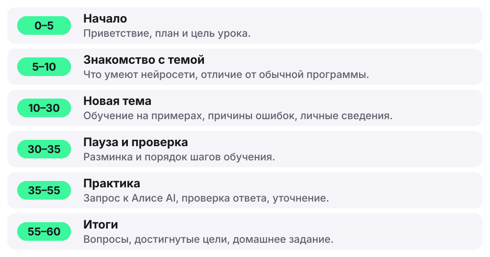

**Текст для учителя:**

Вот план занятия. Сначала разберёмся, что умеют нейросети и как они учатся. Потом короткая пауза. Затем практика: каждый сам напишет запросы Алисе AI и проверит ответы. В конце подведём итоги.

**Действие:** слушать. Подробно на плане не останавливаться.

### Слайд 3. Цель урока

**Время:** 03–05.

**На экране:** подпись «Цель · что будет в конце», формулировка цели и две карточки: «Узнаете» и «Сделаете».

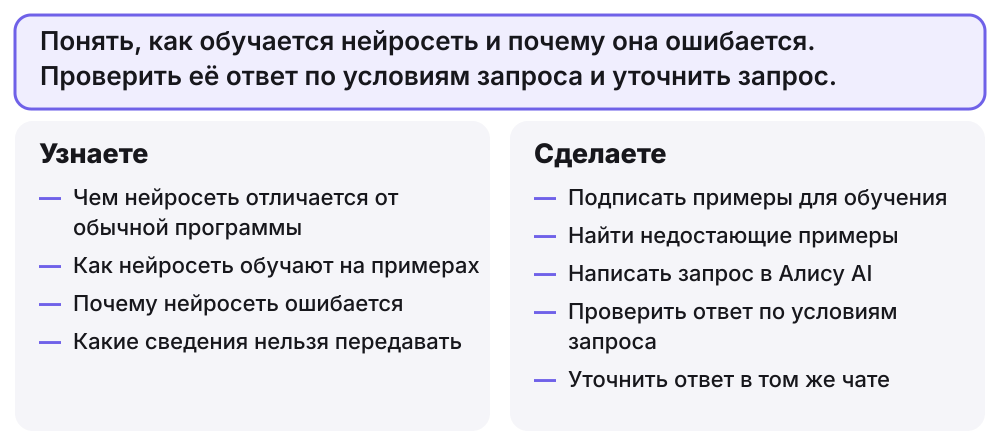

**Текст для учителя:**

Прочитаю цель урока. Понять, как обучается нейросеть и почему она ошибается. Проверить её ответ по условиям запроса и уточнить запрос.

Слева то, что вы узнаете. Справа то, что сделаете. Итог практики: ваши запросы и ответы в чате Алисы AI.

**Какой пункт сейчас кажется самым трудным?** Покажите или напишите в чат. В конце урока вернёмся к этому вопросу. Заранее знать ответы не нужно.

**Действие:** выбрать самый трудный пункт и показать или написать его в чат. В группе больше восьми человек ответы собираются в чат.

---

## Блок 2. Знакомство с темой (05–10)

### Слайд 4. Что умеют нейросети

**Время:** 05–07.

**На экране:** четыре карточки со значками: «Переводят», «Слышат», «Пишут», «Рисуют». Внизу вопрос. Ответ открывается после голосования.

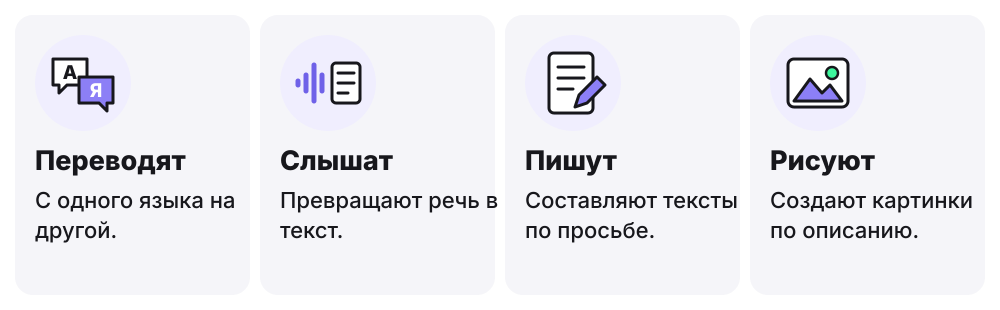

**Ответ после обсуждения:** Часто для разных задач обучают разные нейросети. Умеет она только то, чему её обучили.

**Текст для учителя:**

Есть особые компьютерные программы, их называют нейросетями. Вот что они умеют: переводить с языка на язык, превращать речь в текст, составлять тексты, создавать картинки.

**Как думаете: всё это умеет одна нейросеть или разные?** Поднимите один палец, если одна, и два, если разные. Здесь важно ваше предположение, а не правильный ответ.

Открываю ответ. Часто для разных задач обучают разные нейросети, хотя бывают и такие, что умеют несколько дел сразу. Нейросеть, которая хорошо пишет тексты, не обязательно хорошо различает картинки. Умеет она только то, чему её обучили.

А как её обучают? Сначала разберём простую задачу: определить цифру, написанную от руки. Такие нейросети существуют давно. Затем перейдём к текстам.

**Действие:** показать один палец, если всё умеет одна нейросеть, и два, если разные. Ответ преподаватель открывает после голосования пробелом.

### Слайд 5. Обычная программа и нейросеть

**Время:** 07–10.

**На экране:** две схемы рядом. Слева калькулятор: «2 + 3», «Сложить», «5». Справа три единицы и три семёрки, написанные по-разному, и вопрос «Какое правило?».

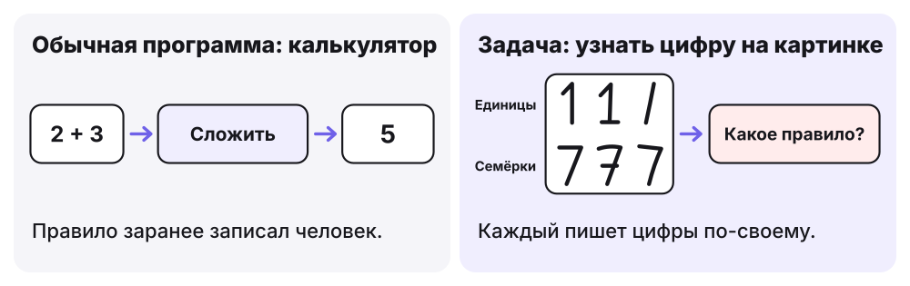

**Ответ после обсуждения:** Точное правило придумать трудно, поэтому нейросеть учат на примерах.

**Текст для учителя:**

Слева калькулятор. Человек заранее записал правило: чтобы получить сумму, надо сложить числа. Программа всегда делает именно это. Два плюс три всегда будет пять.

Справа другая задача: компьютер получает картинку и должен узнать, какая на ней цифра. Посмотрите: все единицы написаны по-разному, и семёрки тоже. **Какое правило точно отличит единицу от семёрки?** Подумайте десять секунд и предложите правило.

Проверим ваше предложение. Если вы говорите: «У семёрки есть верхняя черта», посмотрите на вторую единицу. У неё тоже есть черта. Если говорите: «Единица стоит прямо», посмотрите на третью: она с наклоном. На каждое правило находится исключение.

Поэтому поступают иначе. Точное правило не записывают, а показывают нейросети очень много примеров. Запомните разницу: обычной программе правила дают заранее, а нейросеть настраивается по примерам.

**Действие:** подумать десять секунд и предложить правило голосом или в чат. Преподаватель находит на схеме исключение.

---

## Блок 3. Новая тема (10–30)

### Слайд 6. Нейросеть обучают на примерах

**Время:** 10–13.

**На экране:** восемь цифр от руки, под каждой знак вопроса. После ответов детей вместо него открываются подписи.


**Ответ после обсуждения:** Это правильные подписи. Картинка с подписью становится примером для обучения.

**Текст для учителя:**

Сейчас вы сделаете то, с чего начинается обучение. На экране восемь картинок. Нейросеть пока не знает, что на них.

**Какая цифра на каждой картинке?** Я показываю по очереди, вы называете. Заметьте: единиц и семёрок здесь по две, и выглядят они по-разному.

Открываю подписи. Подпись показывает правильный ответ к картинке. Когда картинка и подпись вместе, получается пример для обучения. **Зачем нужна подпись, если мы и так видим цифру?** Нейросеть будет сравнивать с ней свой ответ. Если подпись неверная, она будет мешать обучению.

Восьми картинок мало. Для настоящих нейросетей собирают тысячи и больше таких примеров, написанных разными людьми. Теперь у нас есть определение: нейросетью называют программу, которая учится на примерах.

**Действие:** назвать цифру на каждой картинке. На индивидуальном занятии ребёнок называет все восемь. После ответов преподаватель открывает подписи пробелом.

### Слайд 7. Как проходит обучение

**Время:** 13–16.

**На экране:** четыре шага слева направо: «Пример», «Попытка», «Сравнение», «Настройка». Ниже плашка о том, что шаги повторяются.

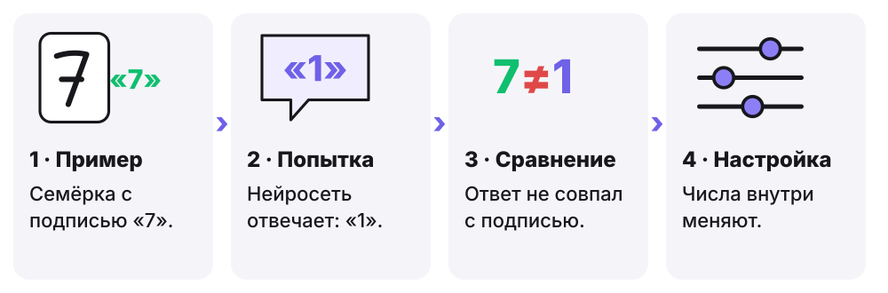

**Ответ после обсуждения:** Нет. Цифры пишут по-разному, поэтому примеров нужно много.

**Текст для учителя:**

Пройдём по схеме. Первый шаг: нейросеть получает картинку. Правильная подпись к ней: семёрка. Второй шаг: попытка. Представим, что она ответила «единица». Третий шаг: ответ сравнивают с подписью. Не совпало, значит, ошибка.

Четвёртый шаг: настройка. Внутри нейросети много связанных между собой вычислений, а силу связей задают числа. Представьте очень много маленьких регуляторов, как у громкости. После ошибки специальная программа чуть-чуть подкручивает их, чтобы в следующий раз ошибка была меньше. Человек эти регуляторы вручную не двигает.

Затем следующий пример, и так снова и снова. **Хватит ли одного примера?** Объясните почему. Цифры пишут по-разному, поэтому одного мало.

Часть картинок откладывают и при обучении не показывают. На них потом проверяют, справляется ли нейросеть с тем, чего не видела.

**Действие:** ответить, хватит ли одного примера, и объяснить почему.

### Слайд 8. Цифра или просто цвет?

**Время:** 16–19.

**На экране:** слева примеры для обучения: фиолетовые единицы и зелёные семёрки. Справа новая зелёная единица и облачко «Нейросеть могла бы ответить: Это 7». Ответ открывается после обсуждения.

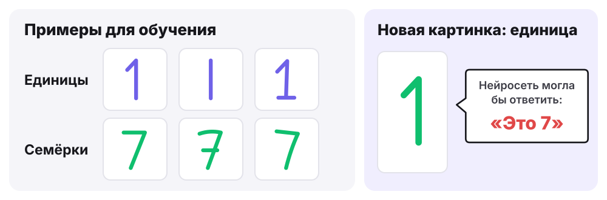

**Ответ после обсуждения:** Зелёный всегда совпадал с семёркой: нейросеть могла опереться на цвет.

**Текст для учителя:**

Представим такую историю. Единицы для примеров писал один человек фиолетовой ручкой, а семёрки другой человек зелёной. На этих примерах нейросеть почти не ошибается. Кажется, что всё отлично.

Теперь новая картинка: единица, но зелёная. Представим, что нейросеть ответила «семь». Мы сами сразу видим единицу. **Почему нейросеть могла ответить «7»?** Сначала подумайте молча десять секунд.

Никто не говорил нейросети смотреть именно на форму. В примерах цвет подходил для ответа каждый раз, поэтому она могла настроиться и на него. Такой признак только кажется важным: он случайно совпал с ответом.

Учёные проверяли похожий случай с цветными цифрами: когда цвет совпадал с ответом, нейросеть чаще всего отвечала верно, а когда цвета поменяли, стала ошибаться намного чаще.

**Действие:** десять секунд подумать молча, затем предложить причину голосом или в чат.

### Слайд 9. Каких примеров не хватает?

**Время:** 19–22.

**На экране:** таблица «цифра и цвет», две клетки со знаком вопроса. После обсуждения в них появляются цифры. Справа блок «Что дальше».

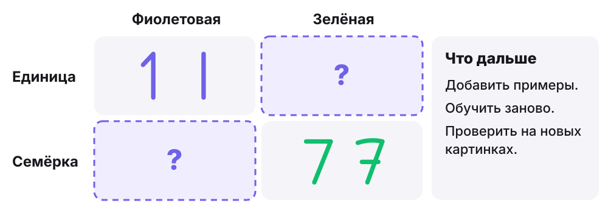

**Ответ после обсуждения:** Зелёные единицы и фиолетовые семёрки. Цвет больше не подсказывает ответ.

**Текст для учителя:**

Вот наши примеры в виде таблицы. В строках цифры, в столбцах цвета. Две клетки заполнены, две пустые.

**Какие картинки нужно добавить в пустые клетки?** Покажите рукой или напишите в чат: зелёная единица и фиолетовая семёрка. Открываю ответ. Теперь и единица, и семёрка бывают обоих цветов. Цвет больше не помогает угадать.

Просто добавить картинки недостаточно: нейросеть нужно обучить заново и снова проверить на новых картинках. Ошибки всё равно могут быть, но опираться на цвет теперь бесполезно.

Так находят причину многих ошибок. Смотрят на число примеров и на то, какие они разные. **Скажите одной фразой, зачем нужны разные примеры.** Например: чтобы нейросеть не опиралась на случайный признак.

**Действие:** показать рукой или написать в чат, какие картинки нужны в пустых клетках. Затем одной фразой сказать, зачем нужны разные примеры.

### Слайд 10. Нейросеть отвечает догадкой

**Время:** 22–25.

**На экране:** неразборчивая цифра, нейросеть из связанных кружков, три полосы с ответами и подпись о том, что длина полос условная.

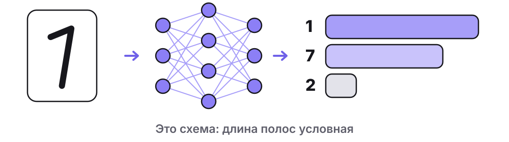

**Ответ после обсуждения:** Заранее неизвестно, поэтому нейросеть проверяют на новых картинках.

**Текст для учителя:**

Посмотрите на картинку слева. Цифра написана неразборчиво. **Что здесь написано: единица или семёрка?** Покажите один палец или семь пальцев. Мы и сами можем ответить по-разному.

Нейросеть получает картинку и считает. Внутри много связанных между собой частей, на схеме это кружки. В конце она оценивает, какая цифра подходит больше всего. Полосы на схеме показывают такую оценку: чем длиннее, тем больше подходит. Длина полос здесь условная, настоящую нейросеть мы не запускали.

**Как думаете: на эту цифру нейросеть ответит верно?** Покажите большой палец вверх или вниз.

Заранее этого не знаем. Нейросеть справляется с тем, что похоже на её примеры, а необычное и неразборчивое может оказаться трудным. Поэтому её проверяют на новых картинках, а важный ответ проверяет человек.

**Действие:** показать один палец, если на картинке единица, и семь, если семёрка. Затем большой палец вверх или вниз: ответит ли нейросеть верно.

### Слайд 11. А как появляется новый текст?

**Время:** 25–28.

**На экране:** слева фраза «Кот залез на…» и три продолжения с полосами разной длины, справа пример уверенной ошибки. Внизу плашка об обучении и разговоре.

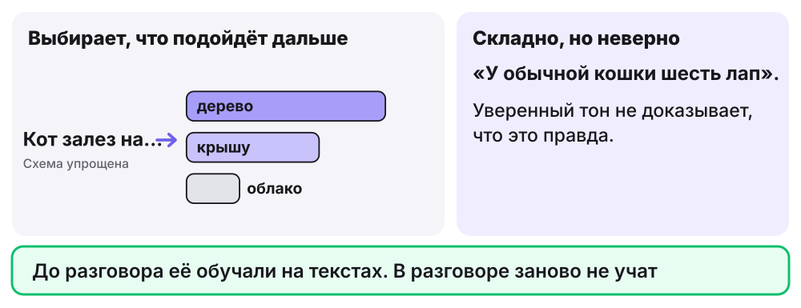

**Ответ после обсуждения:** Проверим в энциклопедии или спросим взрослого. У кошки четыре лапы.

**Текст для учителя:**

Теперь другая задача: не определить цифру, а написать текст. Такую нейросеть обучали на множестве текстов. Получив просьбу, она составляет ответ по кусочкам: каждый раз выбирает, что лучше подойдёт дальше. На схеме упрощённо: после слов «Кот залез на…» чаще подойдёт «дерево», реже «облако».

Нейросеть выбирает то, что звучит подходяще. Поэтому она может написать складно и неверно, да ещё уверенным тоном. **Нейросеть написала: «У обычной кошки шесть лап». Что сделаем?** Проверим в энциклопедии или спросим взрослого.

И ещё одна разница. **Если в чате написать «поменяй имя», мы заново обучим нейросеть?** Нет. Мы уточним просьбу и получим другой ответ. Нейросеть обучают разработчики до нашего разговора.

Скоро в практике мы сами будем проверять ответ и просить его исправить.

**Действие:** ответить, что делать с фразой про шесть лап и обучают ли нейросеть заново, когда просят поменять имя.

### Слайд 12. Что нельзя писать в чат?

**Время:** 28–30.

**На экране:** образец запроса без личных сведений и две карточки: «Можно писать» и «Оставляем при себе».

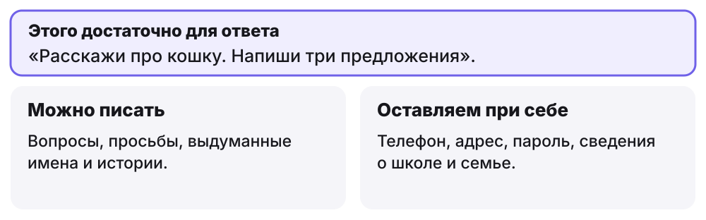

**Ответ после обсуждения:** Нет. Для этой просьбы адрес не нужен. Если сервис просит лишнее, зовём взрослого.

**Текст для учителя:**

Перед практикой решим, что можно писать нейросети. Для обычной просьбы хватает самой просьбы. Ваши фамилии, телефоны и домашние адреса для этого не нужны.

**Нужен ли домашний адрес, чтобы узнать про кошек?** Нет. Достаточно написать: «Расскажи про кошку». Всё, что вы пишете в чат, уходит в сервис, поэтому личное оставляем при себе.

**Если программа неожиданно попросит пароль или фотографию школьного пропуска, что делаем?** Ничего не вводим и зовём взрослого. Для наших заданий это не нужно.

В практике вы сами будете писать запросы в Алису AI, проверять ответ и уточнять его. Создавать аккаунт и вводить пароль вам не нужно: если сайт просит войти, зовите взрослого.

**Действие:** ответить на два вопроса голосом или в чат. Не просить детей называть настоящие сведения даже как плохой пример.

---

## Блок 4. Пауза и проверка (30–35)

### Слайд 13. Пауза для движения

**Время:** 30–32.

**На экране:** зелёный разделитель и три действия для паузы.

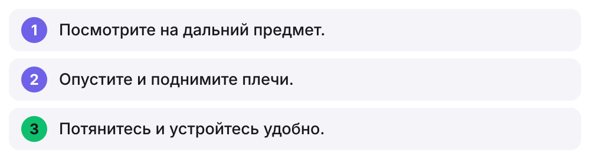

**Текст для учителя:**

Сделаем короткую паузу. Можно встать, если рядом свободно и удобно. Можно остаться сидя и делать только те движения, которые вам подходят.

Сначала отведите взгляд от экрана и посмотрите на дальний предмет в комнате. Не нужно называть его вслух. Дадим глазам отдохнуть от близкого экрана.

Теперь опустите плечи. Спокойно поднимите их и снова опустите. Потянитесь вверх, если удобно. Не тянитесь резко и не старайтесь выше других.

Ещё раз спокойно потянитесь и вернитесь в удобное положение. Проверьте, не мешают ли предметы рядом.

**Готовы продолжать?** Покажите большой палец.  Следующее задание устное.

**Действие:** посмотреть вдаль, опустить и поднять плечи, потянуться. Вставать необязательно, соревнований нет.

### Слайд 14. Восстановите порядок работы

**Время:** 32–35.

**На экране:** три шага в перепутанном порядке. Порядок открывается после ответов.

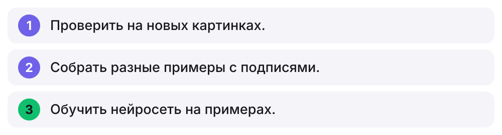

**Ответ после обсуждения:** 2, 3, 1. Сначала собирают примеры, затем обучают, после проверяют на новых картинках.

**Текст для учителя:**

Проверим, что запомнилось перед практикой. На слайде три шага, но порядок перепутан. Первый номер означает «проверить», второй «собрать», третий «обучить».

**В каком порядке идут эти шаги?** Сначала подумайте самостоятельно. Через пятнадцать секунд покажите первый номер пальцами. Затем можно написать всю последовательность в чат.

Прочитаем порядок: собираем разные примеры с правильными подписями, обучаем нейросеть, проверяем её на новых картинках.

**Почему на последнем шаге недостаточно взять только знакомые картинки?** Нам нужно узнать, справится ли нейросеть с тем, чего не видела.

**Представьте: все двойки в примерах написаны на жёлтой бумаге, а все тройки на белой. Какую ошибку может сделать нейросеть и какие картинки вы добавите?** Если трудно, вспомните цветные единицы и семёрки. Сейчас важнее объяснить связь, чем быстро произнести номера.

**Действие:** через пятнадцать секунд показать первый номер пальцами, затем написать порядок в чат. После этого решить задачу про жёлтую бумагу устно.

---

## Блок 5. Практика в Алисе AI (35–55)

### Слайд 15. Практика: откройте Алису AI

**Время:** 35–38.

**На экране:** четыре шага: открыть сайт, начать новый чат, найти поле, позвать взрослого, если просят войти или ввести личные сведения.

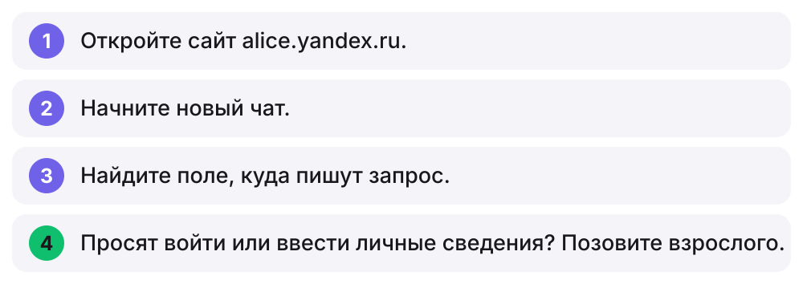

**Текст для учителя:**

Начинаем практику. Теперь работаете вы, а я помогаю. Сегодня вы сделаете первые шаги в работе с нейросетью: напишете запрос, проверите ответ и попросите что-то изменить.

Откройте Алису AI и начните новый чат. Найдите поле внизу, куда пишут сообщение. Пока ничего не отправляем.

**У всех открылся чат?** Покажите большой палец. Если что-то не открывается, напишите мне в чат урока.

**Действие:** открыть сайт и новый чат, найти поле запроса, показать большой палец. На индивидуальном занятии ребёнок работает со взрослым. В группе на каждого ребёнка или пару нужен подготовленный доступ. Взрослый помогает с чтением и вводом, решения принимает ребёнок.

### Слайд 16. Шаг 1. Напишите запрос

**Время:** 38–41.

**На экране:** образец запроса «Расскажи про [кошку]. Напиши три предложения.» и три шага.

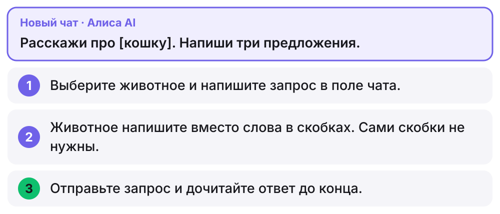

**Текст для учителя:**

Запрос — это просьба к нейросети. На экране образец. Выберите животное, про которое вам интересно узнать, и напишите его вместо слова в скобках. Сами скобки писать не нужно. Например: «Расскажи про жирафа. Напиши три предложения».

Трудно печатать? Образец есть в чате урока, его можно скопировать и заменить одно слово.

Отправьте запрос. Дождитесь ответа и дочитайте его до конца. Если трудно читать, попросите взрослого прочитать вслух.

**Ответ пришёл?** Покажите большой палец.

**Действие:** выбрать животное, написать запрос, отправить, дочитать ответ, показать большой палец. Преподаватель присылает образец в чат урока кнопкой «Скопировать запрос» в заметках.

### Слайд 17. Шаг 2. Проверьте ответ

**Время:** 41–44.

**На экране:** три вопроса для проверки ответа.

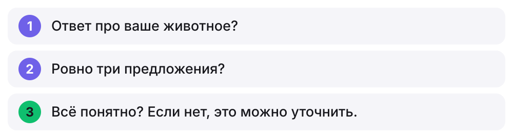

**Текст для учителя:**

Нейросеть может ошибиться, поэтому ответ всегда читаем и проверяем. Сегодня проверяем самое простое: выполнила ли она нашу просьбу. Посмотрите, про ваше ли животное ответ. Посчитайте предложения. Подумайте, всё ли понятно.

Искать ошибку любой ценой не нужно. Если всё выполнено, это тоже результат проверки.

**Всё совпало?** Один палец: да. Два пальца: что-то не так. Кто показал два, скажите, что именно.

Если какой-то факт кажется странным, спросите взрослого. Складный ответ не всегда верный.

**Действие:** проверить ответ по трём вопросам, показать один палец, если всё совпало, и два, если что-то не так. Кто показал два, говорит, что именно.

### Слайд 18. Шаг 3. Уточните ответ

**Время:** 44–48.

**На экране:** три просьбы на выбор: «Объясни проще», «Сделай короче», «Добавь один интересный факт». Ниже три шага.

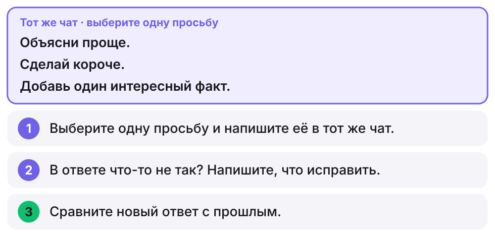

**Текст для учителя:**

Первый ответ не обязательно последний. Разговор можно продолжить и попросить сделать иначе. Заново всё объяснять не нужно: пишем в тот же чат.

Выберите одну просьбу на экране. Если в прошлом ответе было не три предложения, напишите: «Напиши ровно три предложения».

Мы не обучаем нейросеть заново. Мы уточняем просьбу и получаем другой ответ.

**Что изменилось в ответе?** Напишите одно-два слова в чат урока.

**Действие:** выбрать одну просьбу, написать в тот же чат, сравнить новый ответ с прошлым, написать одно-два слова в чат урока.

### Слайд 19. Шаг 4. Попросите сочинить

**Время:** 48–51.

**На экране:** образец запроса на загадку и три шага.

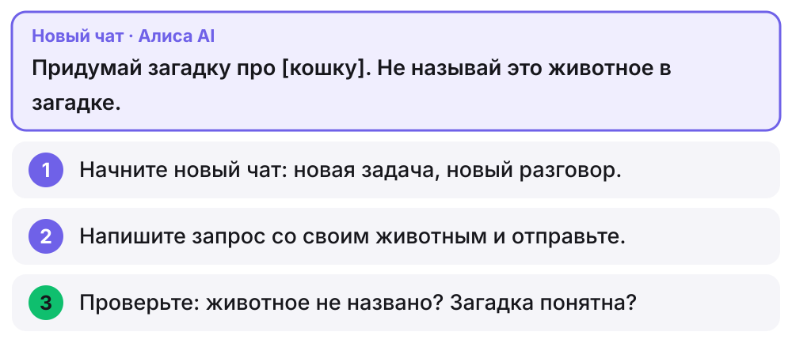

**Текст для учителя:**

Нейросеть умеет не только рассказывать, но и сочинять. Попросим её придумать загадку про ваше животное.

Для новой задачи начните новый чат: так прошлый разговор не будет мешать. Напишите запрос и отправьте.

Прочитайте загадку и проверьте её. Если животное всё же названо, уточните в этом же чате: «Не называй животное».

**Получилась загадка?** Покажите большой палец или напишите в чат, что не так.

**Действие:** начать новый чат, написать запрос со своим животным, проверить загадку, при необходимости уточнить. Показать большой палец или написать, что не так.

### Слайд 20. Шаг 5. Напишите свой запрос

**Время:** 51–55.

**На экране:** четыре шага своего запроса и плашка о личных сведениях.

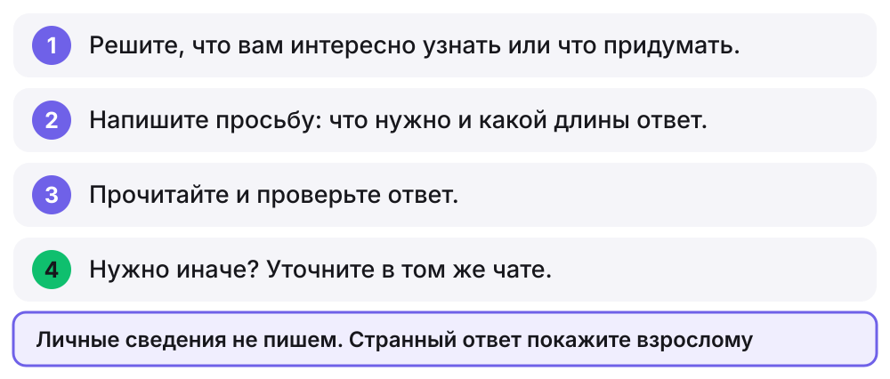

**Текст для учителя:**

Теперь запрос полностью ваш. Что вам интересно узнать или что хочется придумать? Можно спросить, почему идёт дождь, или попросить название для команды. Напишите, что нужно и какой длины ответ. Если трудно печатать, продиктуйте взрослому: запрос всё равно ваш.

Прочитайте ответ и проверьте, выполнена ли просьба. Если нужно иначе, уточните в том же чате.

Личные сведения не пишем. Если ответ странный или неприятный, покажите его взрослому.

**Кто готов прочитать свой запрос и рассказать, что получилось?** Послушаем двоих. Вы сделали первые шаги в работе с нейросетью: написали запрос, проверили ответ и уточнили его.

**Действие:** выбрать тему, написать запрос сами, проверить ответ, при необходимости уточнить. Двое рассказывают, что получилось. Примеры тем давать только тем, кто не может выбрать.

---

## Блок 6. Итоги и домашнее задание (55–60)

### Слайд 21. Три вопроса без подсказки

**Время:** 55–57.

**На экране:** три вопроса на белом слайде с волнами. Ответы открываются после обсуждения.

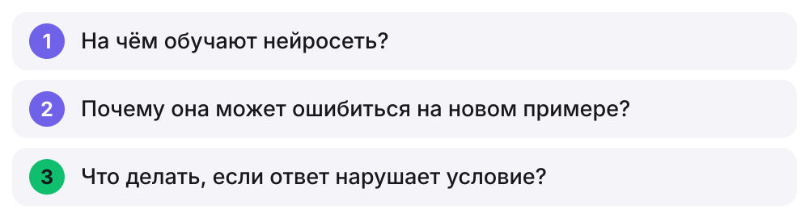

**Ответ после обсуждения:** 1. На примерах с подписями. 2. Мог подвести случайный признак или непохожий пример. 3. Найти нарушение, попросить исправить, проверить снова.

**Текст для учителя:**

Закроем подсказки и ответим на три вопроса. **На чём обучают нейросеть? Почему она может ошибиться на новом примере? Что делать, если ответ нарушает условие запроса?**

Выберите вопрос, на который готовы ответить. Достаточно одной фразы, но добавьте пример. Можно вспомнить зелёную единицу или проверку ответа Алисы AI.

Послушаем три ответа. В первом важно услышать «на примерах». Во втором нужна причина: случайный признак или непохожий пример. В третьем нужны конкретная проверка, просьба об изменении и повторная проверка.

Если вы пока можете сказать только «нейросеть ошибается», уточним: **какую ошибку мы нашли и как заметили?** Например, посчитали предложения и сравнили с запросом. Такое объяснение показывает, что вы поняли, как проверять.

**Действие:** выбрать один вопрос, ответить одной фразой и добавить пример. Ответы преподаватель открывает пробелом.

### Слайд 22. Итоги урока

**Время:** 57–58.

**На экране:** зелёный блок о достигнутой цели и две карточки: «Узнали» и «Сделали», те же пункты, что на слайде 3. Внизу вопрос о самом трудном пункте.

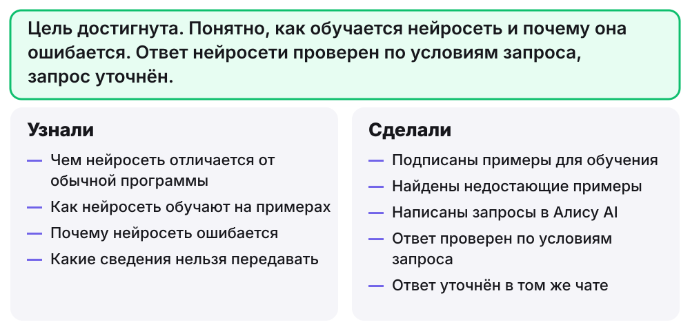

**Текст для учителя:**

Вернёмся к цели, которую мы читали в начале урока. Цель достигнута. Слева то, что вы узнали, справа то, что сделали. Это те же пункты, что были на слайде с целью.

**Какой пункт в начале урока казался самым трудным? Понятен ли он теперь?** Один палец: теперь понятен. Два пальца: нужен ещё разбор. За ответ оценку не ставим.

Показали два пальца? Напишите в чат одно слово: «обучение», «проверка» или «запрос». Так я пойму, что объяснить дополнительно.

**Действие:** показать один палец, если трудный пункт стал понятен, и два, если нужен ещё разбор. Кто показал два, пишет в чат одно слово.

### Слайд 23. Создайте что-то своё

**Время:** 58–59.

**На экране:** подпись с длительностью, три карточки с форматами: загадка, мини-сказка, открытка. Ниже строка о своём формате.

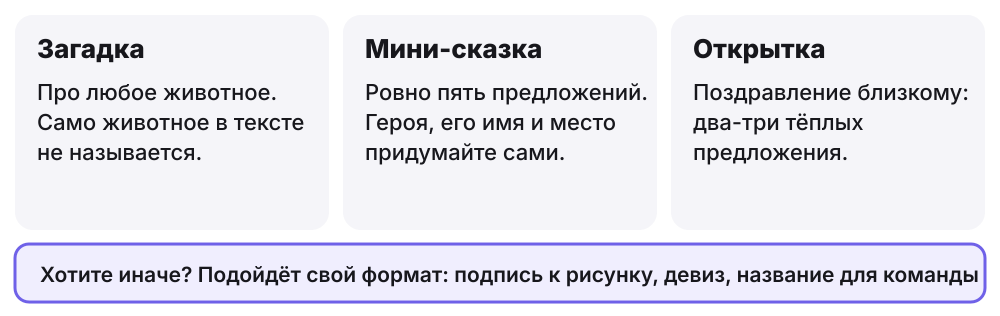

**Текст для учителя:**

Домашнее задание займёт около пятнадцати минут. Вы создадите что-то своё вместе с нейросетью: загадку, мини-сказку или открытку. Можно придумать свой формат, например девиз или подпись к рисунку. Работайте в Алисе AI вместе со взрослым: если сайт просит войти, это делает взрослый.

Три шага те же, что на уроке. Напишите запрос: что нужно, о чём и какой длины. Проверьте ответ: нейросеть сделала то, что вы просили? Нет ли странного? Нравится ли вам результат? Если нет, уточните в том же чате и сравните, что изменилось.

Настоящие имена, телефоны, адреса и школу не пишем.

**Действие:** выбрать формат и понять три шага. Заранее предупредите родителей, что для задания нужны взрослый и доступ к Алисе AI. Нет доступа дома: задание можно сделать на следующем занятии.

### Слайд 24. Как это может выглядеть

**Время:** 59–60.

**На экране:** две карточки рядом: первый запрос с проверкой и уточнение с проверкой. Ответы подготовлены для урока.

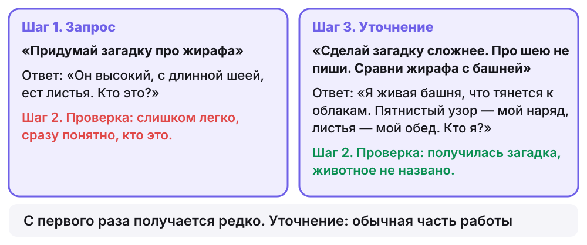

**Текст для учителя:**

Вот пример на загадке про жирафа. Первый запрос короткий. Ответ есть, но отгадка понятна сразу. Это и есть проверка: мы хотели загадку, а получилось простое описание.

Поэтому пишем в том же чате, что поправить: сделать сложнее, не писать про шею, сравнить жирафа с башней. **Что изменилось в новом ответе?** Покажите большой палец, если заметили разницу.

С первого раза получается редко. Уточнение — не провал, а обычная часть работы. Ответы здесь подготовлены для урока, у вас они будут другими.

На сегодня заканчиваем. До встречи!

**Действие:** показать большой палец, если заметили разницу между ответами. Ответы в примере подготовлены заранее, не выдавайте их за ответы Алисы AI.

---

## Запасной план, если Алиса AI недоступна

Эти тексты написаны заранее и не получены от Алисы AI. Скажите об этом детям прямо. Настоящие запросы перенесите на следующее занятие и не отмечайте их выполненными.

**Как меняется ход практики.** Слайд 15 пропустите. На слайдах 16–18 дети не отправляют запросы: преподаватель читает учебные ответы, а дети проверяют их по шагам на экране. Слайды 19 и 20 перенесите на следующее занятие.

**Слайды 16–17, учебный ответ на запрос про кошку.** В нём специально четыре предложения вместо трёх, чтобы проверка нашла, что исправить: «Кошка — домашнее животное. Она хорошо видит в темноте. Кошки любят много спать. У них мягкие лапы и длинные усы».

**Слайд 18, уточнение «Напиши ровно три предложения».** Учебный ответ, он же открывается кнопкой в заметках: «Кошка — домашнее животное. Она хорошо видит в темноте. Кошки любят много спать».

**Слайд 22.** Скажите, что запросы и уточнение перенесены: эти пункты пока не выполнены.

## Карта теории: что сказано детям и откуда это взято

Теория урока опирается на документацию и научные работы и упрощена по словам. Цитаты сверены 3 ноября 2026 года, кроме условий сервиса: см. раздел «Источники для преподавателя».

| Слайд | Что слышат дети | Что написано в источнике | Что упрощено |
|---|---|---|---|
| 5, 6 | Нейросеть учится на примерах и настраивается по ним | Google: «Neural networks are a family of model architectures designed to find nonlinear patterns in data» | «Нелинейные закономерности» заменены словами «учится на примерах» |
| 7 | Внутри много связанных вычислений, силу связей задают числа | Google: значение нейрона считается как сумма произведений входов и весов: «the sum of the product of each of its inputs… and a unique weight parameter, plus the bias» | Веса названы числами и сравнены с регуляторами. Сравнение придумано для урока |
| 7 | После ошибки программа подкручивает числа, чтобы ошибка стала меньше | Google: «The backpropagation training algorithm makes use of the calculus concept of a gradient to adjust model weights to minimize loss» | Градиент и функция потерь не упоминаются |
| 7, 14 | Часть картинок откладывают и проверяют на них | Google: «You should test a model against a different set of examples than those used to train the model» | Обучающие, проверочные и тестовые наборы не различаются |
| 8, 9 | Нейросеть могла опереться на случайно совпавший признак | Geirhos и соавторы: «Shortcuts are decision rules that perform well on standard benchmarks but fail to transfer to more challenging testing conditions» | Термин не вводится. Цветные ручки придуманы для урока |
| 8 | Учёные проверяли похожий случай с цветными цифрами | Arjovsky и соавторы, таблица 1, Colored MNIST: обычное обучение (ERM) дало 87,4% на обучающих данных и 17,1% на проверочных | Детям числа не называются. В работе другая задача: две группы цифр, цвет частично совпадает с ответом |
| 11 | Нейросеть составляет текст по кусочкам и выбирает, что подойдёт дальше | Google: «A language model estimates the probability of a token or sequence of tokens occurring within a longer sequence of tokens» | Токен назван кусочком, вероятности заменены полосами условной длины. Токен разбирается на уроке 2 |
| 11, 17 | Нейросеть может ошибаться, поэтому ответ проверяем | Алиса AI: «Алиса AI старается, но может ошибаться. Проверяйте важную информацию» | Без изменений по смыслу |
| 18 | В том же чате можно уточнить ответ, заново объяснять не нужно | Алиса AI: «В чате сохраняется контекст беседы — можно сначала задать вопрос, а потом дополнить его подробностями» | Без изменений по смыслу |

**Что в уроке не теория, а учебный приём.** Калькулятор, задача про единицу и семёрку, цветные ручки, жёлтая бумага, фраза про кошку с шестью лапами и загадка про жирафа написаны для урока. Неразборчивая цифра и полосы на слайде 10 тоже нарисованы для объяснения: это не результат запуска нейросети. Их нельзя подавать как данные или исследования. Правило о личных сведениях на слайде 12 тоже приём урока, а не цитата из источника.

## Источники для преподавателя

Страницы открыты и сверены 3 ноября 2026 года, если не сказано иное. Интерфейс и правила сервиса могут измениться, поэтому перед занятием проверьте их снова.

- [Google: нейросети](https://developers.google.com/machine-learning/crash-course/neural-networks): что такое нейросеть.
- [Google: узлы и скрытые слои](https://developers.google.com/machine-learning/crash-course/neural-networks/nodes-hidden-layers): как считается значение нейрона.
- [Google: обратное распространение ошибки](https://developers.google.com/machine-learning/crash-course/neural-networks/backpropagation): как настраиваются веса.
- [Google: разделение данных](https://developers.google.com/machine-learning/crash-course/overfitting/dividing-datasets): проверка на других примерах.
- [Google: введение в большие языковые модели](https://developers.google.com/machine-learning/resources/intro-llms): вероятность токена.
- [Geirhos и соавторы, 2020](https://arxiv.org/abs/2004.07780): опора нейросети на случайный признак.
- [Arjovsky и соавторы, 2019](https://arxiv.org/abs/1907.02893): цветные цифры, таблица 1.
- [Алиса AI: создание текста](https://alice.yandex.ru/support/ru/assistant/chat/text): предупреждение об ошибках, контекст в чате.
- [Условия использования сервиса «Алиса AI»](https://yandex.ru/legal/alice_chat/), п. 1.7: использование несовершеннолетним. Цитата приведена по сценарию урока 2, при подготовке этого сценария страница не открылась. Сверьте её перед занятием.
