# Текстовый промтинг. Часть 1

Модуль «Нейросети и AI-проекты», урок 2. Сценарий презентации для онлайн-урока: 7–9 лет, 60 минут, Zoom или Телемост. Дети видят только слайды. Спикерскую речь видит только преподаватель.

**Вопросы детям выделены жирным.** Речь написана на «вы» и подходит для группы и для одного ученика. Что меняется на индивидуальном занятии, указано в строке «Действие».

## Расписание

| Время | Блок | Слайды | Минут |
|---|---|---|---|
| 00–05 | Приветствие, план и цель | 1–3 | 5 |
| 05–10 | Домашнее задание и повторение первого урока | 4–5 | 5 |
| 10–27 | Новая тема с разминкой внутри | 6–12 | 17 |
| 27–55 | Практика в Алисе AI: мини-проект «Сценарий игры» | 13–22 | 28 |
| 55–60 | Итоги и домашнее задание | 23–26 | 5 |

Интерактивные паузы:

| Минута | Что происходит | Слайд |
|---|---|---|
| 05–08 | Рассказ о домашней игре и «Верно или неверно» | 4 |
| 12–15 | Голосование про торты | 7 |
| 15–18 | Разминка «Живой промт» | 8 |
| 22–25 | Поиск недостающей части промта | 11 |
| 27–46 | Практика: действие и ответ каждые 1–5 минут | 13–19 |
| 46–48 | Пауза для глаз и плеч | 20 |
| 48–55 | Свой промт и показ результата | 21–22 |

## Подготовка преподавателя

**Согласие и взрослый рядом**

- Условия сервиса (п. 1.7) допускают использование несовершеннолетним «с ведома и согласия его законного представителя и под его контролем». Законный представитель сам знакомится с условиями и принимает их. Получите его согласие до урока.
- В том же пункте сказано, что Яндекс «не гарантирует отсутствие в Сервисе информации, не соответствующей возрастной категории». Поэтому на время практики взрослый сидит рядом: контролирует, помогает читать и копировать. Решения принимает ребёнок.
- Если нужен вход, его выполняет взрослый. Он же отключает персонализацию, если такая настройка есть. Пароль детям не передаётся.

**Проверка сервиса за день до урока**

- Отправьте все промты урока в [Алису AI](https://alice.yandex.ru). Ответы заранее неизвестны и каждый раз могут отличаться.
- На устройстве ребёнка проверьте, открывается ли сайт и создаётся ли второй чат. Можно ли вернуться в первый чат? Если нет, второй чат открывайте в новой вкладке.
- Найдите кнопку нового чата (в справке это значок в виде облака с плюсом) и кнопку копирования (значок из двух квадратов). Интерфейс может измениться, поэтому при необходимости замените значки на слайдах 13 и 19.

**Техника на уроке**

- Лучше работать с компьютера или со второго устройства: на первом идёт урок. На одном телефоне или планшете переключаться между окнами трудно.
- Заранее пришлите в чат урока ссылку на сайт и подготовьте промты со слайдов 15 и 18. Детям трудно быстро печатать, поэтому они копируют образец и заменяют слова в скобках. Проверьте, вставляется ли длинный текст в чат вашей видеосвязи.
- Дети смотрят на слайд и работают в другом окне, поэтому каждый шаг практики читайте вслух.
- Камера выключена? Ребёнок отвечает цифрой в чат или реакцией вместо жеста.
- Если ответ не приходит больше минуты, пусть ребёнок обновит страницу и отправит промт снова.
- Если Алиса AI недоступна, используйте запасной план из конца документа и прямо скажите, что ответы написаны заранее.

**Показ слайдов.** Где сказано «открывается после ответа», часть схемы показывается вторым шагом. В файлах SVG эти части лежат в группах `step-2`, `step-3` и т. д.

## Что входит в урок и что остаётся на часть 2

В уроке: что такое промт, зачем нужны подробности, три части промта, проверка ответа по условиям, уточнение в том же чате.

На часть 2: роль, образец в промте, разбивка задачи на шаги, проверка фактов по источнику.

Сценарий игры выдуман, поэтому фактов в нём проверять не нужно: дети проверяют только, выполнена ли их просьба. Мини-проект «Сценарий игры» указан в программе модуля, там же есть постер и трейлер к игре.

Детям части промта называются вопросами: «Что сделать?», «Про что?», «Какой нужен ответ?». Похожие шаги есть в справке Алисы AI: определить цель, задать контекст, указать формат ответа. Полного совпадения нет: в справке тема входит в цель, а тон и лексика вынесены в отдельный шаг о стиле. Для детей это упрощение, трёх терминов они не заучивают.

---

## Блок 1. Приветствие, план и цель (00–05)

### Слайд 1. Текстовый промтинг. Часть 1

**Время:** 00–02.

**На экране:** заголовок и подзаголовок «Как попросить нейросеть, чтобы получить задуманное». Схема: три вопроса складываются в просьбу, и появляется ответ.

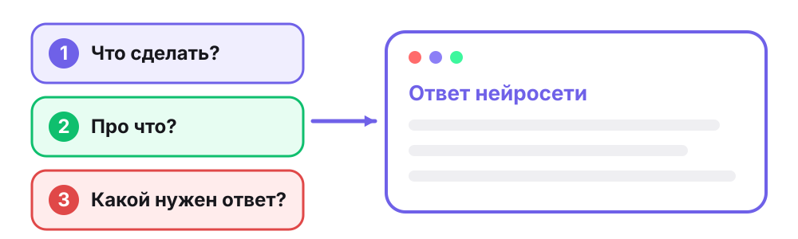

**Текст для учителя:**

Здравствуйте! Если меня хорошо слышно, покажите большой палец.

Начнём с маленькой истории. Представьте, что вы просите друга: «Принеси что-нибудь вкусное». **Как думаете, что он принесёт? Это будет именно то, чего вам хотелось?** Он может принести яблоко, конфету или бутерброд. Друг старался, но мыслей он не читает.

С нейросетью похожая история. Сегодня выясним, как попросить её так, чтобы получить задуманное. А во второй половине урока вы вместе с Алисой AI придумаете сценарий своей игры.

**Действие:** показать большой палец. Назвать голосом или написать в чат, что принесёт друг.

### Слайд 2. Как пройдут 60 минут

**Время:** 02–03.

**На экране:** подпись «Agenda · план занятия», заголовок «Как пройдут 60 минут» и компонент agenda из дизайнбука, пять строк:

- **0–5.** Начало: план и цель урока.
- **5–10.** Повторение: как нейросеть составляет текст.
- **10–27.** Новая тема: из чего состоит промт, разминка.
- **27–55.** Практика: сценарий игры в Алисе AI.
- **55–60.** Итоги и домашнее задание.

**Текст для учителя:**

Вот наш план. Сначала вспомним первый урок, потом разберём новую тему и разомнёмся. Больше всего времени займёт практика: там работаете вы, а я помогаю. В конце подведём итоги, и я расскажу о домашнем задании.

**Действие:** посмотреть план и показать большой палец, если всё понятно.

### Слайд 3. Цель урока

**Время:** 03–05.

**На экране:** подпись «Цель · что будет в конце», блок ek-note с формулировкой и две карточки grid-2.

Формулировка цели: *Составлять промт из трёх частей. Проверять ответ нейросети по условиям промта и уточнять его в том же чате.*

Карточка **Узнаете:**

- Что такое промт
- Почему на короткий промт приходит неожиданный ответ
- Из каких трёх частей состоит промт
- Какие условия можно проверить

Карточка **Сделаете:**

- Найти недостающую часть промта
- Сравнить ответы на короткий и подробный промт
- Составить сценарий игры в Алисе AI
- Уточнить ответ в том же чате
- Написать промт без образца

**Текст для учителя:**

Прочитаю цель урока. Составлять промт из трёх частей. Проверять ответ нейросети по условиям промта и уточнять его в том же чате.

Слово «промт» пока незнакомое, через несколько минут мы его разберём. Слева то, что вы узнаете, справа то, что сделаете. Итог практики: сценарий вашей игры. Мы его сохраним, он ещё пригодится в этом модуле.

**Какой пункт в правой карточке вам хочется попробовать первым?** Назовите его или напишите в чат. В конце урока мы к этому списку вернёмся.

**Действие:** назвать пункт голосом или в чате.

---

## Блок 2. Повторение (05–10)

### Слайд 4. Домашняя игра и «Верно или неверно»

**Время:** 05–08. Интерактивная пауза.

**На экране:** три утверждения и подпись, как отвечать. Ответы открываются после голосования.

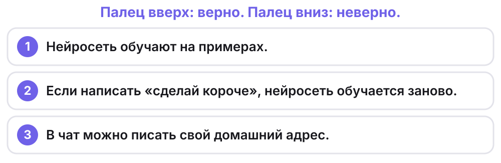

Ответы: 1 верно, 2 неверно, 3 неверно.

**Текст для учителя:**

Сначала о домашнем задании. **Кто дома играл в нейросеть? Что ответил близкий на нового зверька?** Послушаем одного человека. Если близкий ошибся, значит, примеры его подвели. Фото рисунков я посмотрю после урока.

Теперь вспомним прошлый урок. Я читаю утверждение, а вы показываете: большой палец вверх, если верно, вниз, если неверно.

**Нейросеть обучают на примерах. Верно?** Верно: ей показывают множество примеров.

**Если написать в чате «сделай короче», нейросеть обучается заново. Верно?** Неверно. Её обучают разработчики до нашего разговора. А мы уточняем просьбу и получаем другой ответ.

**В чат можно писать свой домашний адрес. Верно?** Неверно. Телефон, адрес и пароль оставляем при себе. Это правило действует и сегодня.

**Действие:** один ребёнок рассказывает о домашней игре. На каждое утверждение все показывают палец вверх или вниз. Кто ошибся, ничего страшного: сразу разбираем.

### Слайд 5. Какое слово дальше?

**Время:** 08–10. Мостик к новой теме.

**На экране:** схема с двумя началами фразы, подписанными «Мало подсказок» и «Много подсказок». Продолжения открываются после ответов детей.

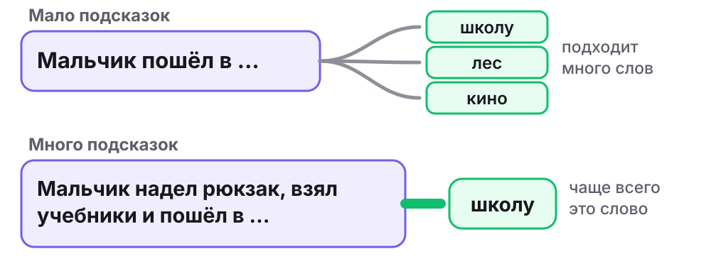

**Текст для учителя:**

На прошлом уроке мы узнали, что текстовая нейросеть составляет ответ по кусочкам и каждый раз выбирает, что лучше подойдёт дальше. Попробуйте сами.

**Мальчик пошёл в… Какое слово дальше?** Скажите или напишите в чат. Открываю схему. Подходит многое: в школу, в лес, в кино.

**А теперь: мальчик надел рюкзак, взял учебники и пошёл в… Какое слово дальше?** Чаще всего скажут «в школу». Рюкзак и учебники подсказали.

**Как думаете, когда выбрать продолжение легче: когда подсказок много или когда мало?** Когда много. Запомните эту мысль, она сейчас пригодится.

*Для преподавателя: схема упрощённая и не показывает настоящих расчётов. Это общий принцип языковых моделей, подробности устройства Алисы AI разработчик не описывает.*

**Действие:** договорить обе фразы голосом или в чате, ответить на вопрос о подсказках. Один ученик называет три подходящих слова к первой фразе, преподаватель добавляет ещё.

---

## Блок 3. Новая тема (10–27)

### Слайд 6. Что такое промт

**Время:** 10–12.

**На экране:** заголовок и определение «Промт — это просьба к нейросети». Схема: человек, промт, нейросеть, ответ.

**Текст для учителя:**

На прошлом уроке вы писали Алисе запросы. Такой запрос называют промтом. Промт — это просьба к нейросети. Отсюда и название сегодняшней темы: промтинг — это умение писать такие просьбы, а «текстовый» значит, что в ответ мы ждём текст.

Посмотрите на схему. Человек пишет промт, нейросеть составляет ответ. Мыслей она не читает. Она опирается на то, что вы написали.

**Что вы просили у Алисы на прошлом уроке?** Вспомните один свой запрос. Вот это и был промт.

**Действие:** назвать один свой запрос с прошлого урока. Не помните? Можно назвать то, о чём хотелось бы спросить.

### Слайд 7. Заказ у кондитера

**Время:** 12–15. Интерактивная пауза.

**На экране:** сначала только левая часть: заказ «Испеките торт» и три разных торта. После обсуждения открывается правая: подробный заказ и один торт.

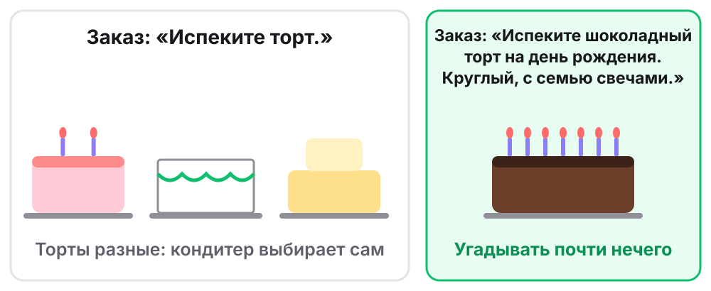

**Текст для учителя:**

Представьте кондитера. Ему пишут: «Испеките торт». Посмотрите на три торта. **Может кондитер испечь любой из них? Покажите один палец, если да, два, если нет.** Да, может: каждый подходит под заказ.

Заказчик ждал шоколадный торт на день рождения, а получил белый с зелёной волной. **Кондитер ошибся? Почему?** Он не ошибся: он выполнил заказ. Чего заказчик хотел на самом деле, кондитер не знал, поэтому выбирал сам.

Открываю вторую половину. «Испеките шоколадный торт на день рождения. Круглый, с семью свечами». **Что теперь решил заказчик, а не кондитер?** Вкус, повод, форму и число свечей. Посчитайте свечи на рисунке.

Помните про подсказки? Подробности в промте и есть подсказки. В справке, это инструкция от создателей Алисы, сказано: чем детальнее запрос, тем лучше результат. Лучше здесь значит ближе к тому, что вы задумали.

**Действие:** проголосовать пальцами, назвать, что решил заказчик, посчитать свечи.

### Слайд 8. Разминка «Живой промт»

**Время:** 15–18. Интерактивная пауза с движением.

**На экране:** строка «Вы — нейросеть. Преподаватель пишет промт», слева короткая просьба и фигурки с подписями. Правая часть открывается после второго промта.

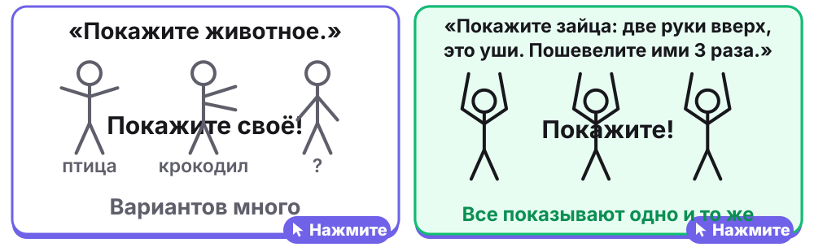

**Текст для учителя:**

Разомнёмся! Сейчас нейросеть — это вы, а я пишу промт. Встаньте, если рядом свободно. Можно делать всё сидя.

Первый промт: «Покажите животное». Покажите! Я задумал(а) кота. Кто-то показал другое животное, и это нормально: вы выполнили просьбу правильно, а мою задумку угадать не могли.

Второй промт: «Покажите зайца: две руки вверх, это уши. Пошевелите ими три раза». Покажите! Теперь совпало с задумкой.

Третий промт придумайте вы. **Какое животное показать и что сделать?** Теперь нейросеть я, выполняю ваш промт. А все остальные повторяют за мной.

Садимся удобно. **В каком промте вы точно знали, что показать? Почему?** Во втором: в нём сказано, что именно нужно сделать.

Настоящая нейросеть устроена не как человек. Эта игра только про то, как просить.

**Действие:** показать животное, затем зайца. Один ребёнок придумывает третий промт, остальные его выполняют. На индивидуальном занятии третий промт придумывает ученик, а выполняет преподаватель.

### Слайд 9. Три вопроса промта

**Время:** 18–20.

**На экране:** заголовок и три цветные карточки с вопросами и номерами. Эти цвета и номера сохраняются до конца урока.

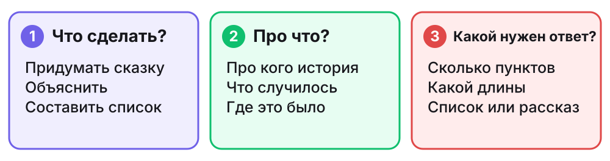

**Текст для учителя:**

Чтобы нейросети не приходилось угадывать, промт отвечает на три вопроса.

Первый: что сделать? Придумать, объяснить, составить список.

Второй: про что? Здесь подробности: про кого история, что случилось, где это было.

Третий: какой нужен ответ? Сколько пунктов, какой длины, список это или рассказ.

Похожие советы есть в справке Алисы AI. Это подсказка, порядок может быть другим, и не каждому промту нужны все подробности. Главное, чтобы важное для вас было написано.

**Вспомните заказ: «Испеките торт». На какой вопрос отвечает слово «испеките»?** Покажите номер пальцами. Первый: это что сделать.

**Действие:** повторить за преподавателем три вопроса, загибая пальцы. Показать номер для слова «испеките».

### Слайд 10. Разбираем промт

**Время:** 20–22.

**На экране:** промт, разделённый цветом на три строки. Подписи к частям открываются по одной.

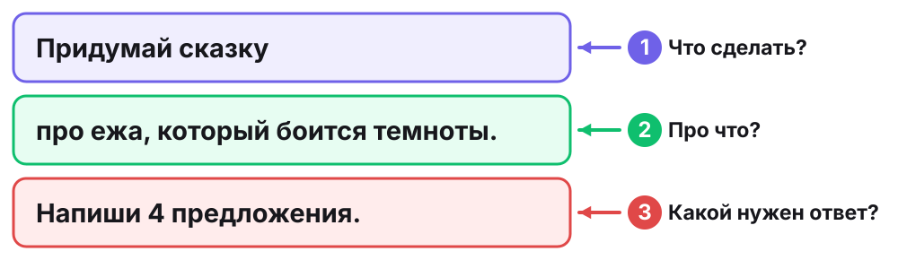

**Текст для учителя:**

Посмотрим на настоящий промт: «Придумай сказку про ежа, который боится темноты. Напиши 4 предложения».

**Где здесь ответ на вопрос «что сделать»?** «Придумай сказку». **Где ответ на вопрос «про что»?** «Про ежа, который боится темноты». **А какой нужен ответ?** «Напиши 4 предложения».

Заметьте: особых слов не нужно. Это обычная понятная просьба, просто в ней сказано всё важное.

**Что изменится в ответе, если вместо ежа написать дракона?** Изменится герой, и история будет другой.

**Действие:** назвать слова из промта для каждого вопроса голосом или в чате.

### Слайд 11. Какой части не хватает?

**Время:** 22–25. Интерактивная пауза.

**На экране:** строка с номерами трёх вопросов, три промта и у каждого три квадрата с вопросительным знаком. После голосования квадраты заполняются, и на месте пропуска появляется слово «нет».

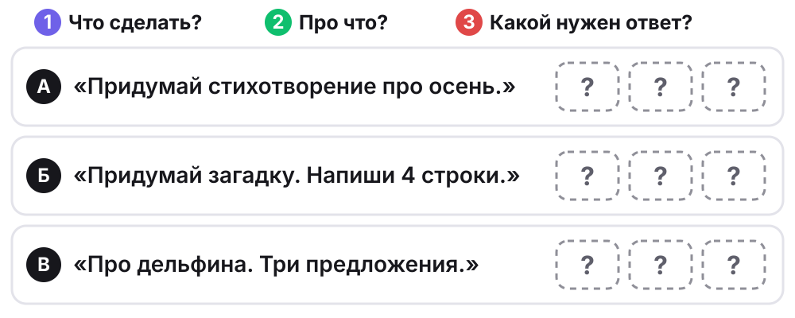

После обсуждения:

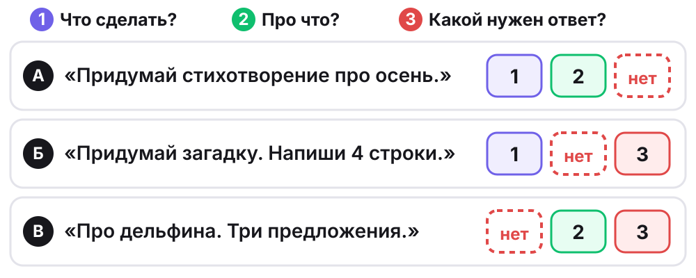

**Текст для учителя:**

Теперь проверяете вы. В каждом промте пропала одна часть. Покажите пальцами её номер: один — «что сделать», два — «про что», три — «какой нужен ответ».

**А: «Придумай стихотворение про осень». Какой части нет?** Третьей: неизвестно, какой длины стихотворение.

**Б: «Придумай загадку. Напиши 4 строки». Какой части нет?** Второй: неизвестно, про что загадка.

**В: «Про дельфина. Три предложения». Какой части нет?** Первой: непонятно, что сделать. Рассказать о дельфине? Сочинить сказку? Придумать загадку?

**Как дополнить промт Б?** Например: «Придумай загадку про снеговика. Напиши 4 строки».

**Действие:** на каждый промт показать номер пальцами. Один ребёнок дополняет промт Б устно.

### Слайд 12. Какой ответ можно проверить?

**Время:** 25–27.

**На экране:** сравнение: «Напиши хорошо» и «Напиши 3 предложения». Подписи снизу открываются после голосования.

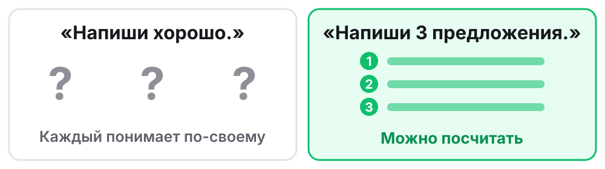

**Текст для учителя:**

Ещё про третью часть. Посмотрите на две просьбы. **Какое условие легко проверить: «напиши хорошо» или «напиши 3 предложения»? Покажите один или два пальца.**

Второе. Предложения можно посчитать. А слово «хорошо» каждый понимает по-своему. Поэтому лучше написать то, что можно проверить: например, «напиши 3 предложения» или «напиши 5 строк».

**Какое точное условие вы написали бы для загадки?** Например, «напиши 4 строки».

**Действие:** показать один или два пальца. Назвать своё точное условие для загадки.

---

## Блок 4. Практика: мини-проект «Сценарий игры» (27–55)

### Слайд 13. Начинаем практику

**Время:** 27–29.

**На экране:** заголовок, строка «Сценарий — это рассказ о том, что происходит в игре: начало, трудности, конец» и схема из трёх шагов. Ниже две подсказки: «Просят войти или ввести личные сведения? Позовите взрослого» и «Ответ странный или неприятный? Покажите взрослому».

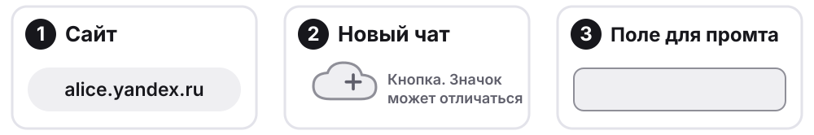

**Текст для учителя:**

Теперь работаете вы, а я помогаю. Сегодня вы придумаете сценарий своей игры. Сценарий — это рассказ о том, что в игре происходит: как она начинается, что мешает герою и чем всё заканчивается. Сначала посмотрим, что выйдет с коротким промтом, потом напишем подробный и сравним.

Ссылка на сайт есть в чате урока. Откройте Алису AI и начните новый чат. Найдите поле, куда пишут сообщение. Пока ничего не отправляем.

Если сайт просит войти или ввести личные сведения, позовите взрослого. Если ответ покажется странным или неприятным, покажите его взрослому.

**У всех открылся чат?** Покажите большой палец. Что-то не открывается? Напишите мне в чат урока.

**Действие:** открыть сайт, начать новый чат, показать большой палец.

### Слайд 14. Шаг 1. Короткий промт

**Время:** 29–32.

**На экране:** промт «Придумай игру.» и четыре вопроса с подписью «В промте нет ответа на эти вопросы».

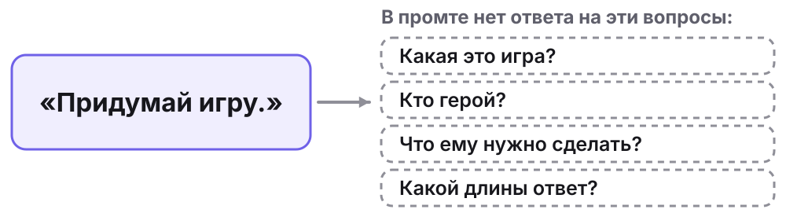

**Текст для учителя:**

Напишите ровно два слова: «Придумай игру». Отправьте и дождитесь ответа. Если трудно читать, попросите взрослого прочитать вслух.

**Что Алиса решила за вас? Какую игру она выбрала? Есть ли там герой?** Напишите в чат одно-два слова или скажите голосом.

Алиса переспросила или предложила несколько игр? Это тоже понятно: вашей задумки она не знает. Если ответ вам понравился, это нормально: на короткий промт иногда приходит удачный ответ. Но выбирала всё равно нейросеть, а не вы.

Запомните этот ответ, сейчас мы его сравним с новым.

**Действие:** отправить промт, прочитать ответ, назвать одну вещь, которую нейросеть решила сама.

### Слайд 15. Шаг 2. Промт из трёх частей

**Время:** 32–37.

**На экране:** образец промта, разделённый цветом на три части, и пример героя. Ниже подсказки: «Начните новый чат», «Слова в скобках замените своими. Скобки сотрите», «Герой выдуманный. Настоящие имена не пишем».

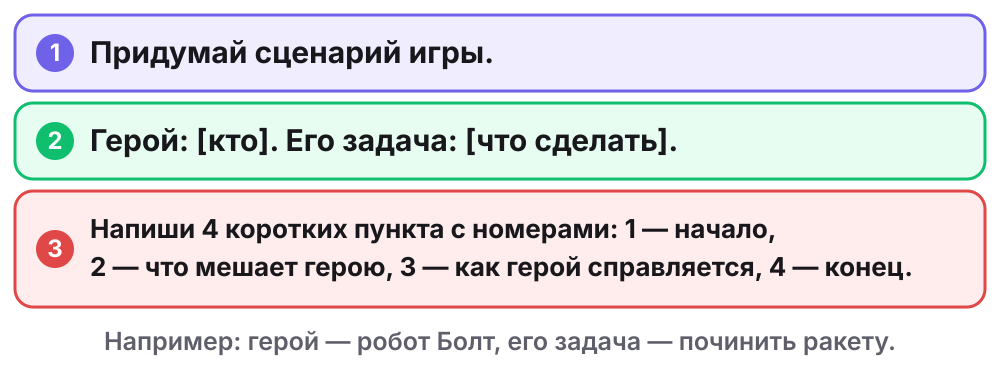

**Текст для учителя:**

Начните новый чат: так первый разговор не будет мешать. В справке Алисы AI сказано, что беседы из разных чатов не смешиваются.

Образец уже в чате урока, скопируйте его в поле для промта. Теперь решите главное. **Кто будет героем вашей игры и что ему нужно сделать?** Герой должен быть выдуманным: настоящие имена и фамилии не пишем. Например, робот Болт, которому нужно починить ракету. У вас будет своё.

Вместо слов в скобках напишите своего героя и его задачу. Скобки сотрите. Отправьте промт.

Пока идёт ответ, посмотрите на образец: где здесь первая часть, вторая, третья?

**Пришёл ответ?** Покажите большой палец.

**Действие:** начать новый чат, придумать героя и задачу, заменить слова в скобках, отправить. Взрослый помогает печатать, героя и задачу придумывает ребёнок.

Промт для чата урока: `Придумай сценарий игры. Герой: [кто]. Его задача: [что сделать]. Напиши 4 коротких пункта с номерами: 1 — начало, 2 — что мешает герою, 3 — как герой справляется, 4 — конец.`

### Слайд 16. Шаг 3. Сравниваем два ответа

**Время:** 37–38.

**На экране:** заголовок двух столбцов. Таблица открывается после голосования.

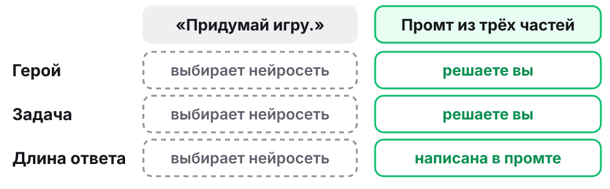

**Текст для учителя:**

Вспомните первый ответ. Если он открыт в другой вкладке, посмотрите на него. **В каком ответе больше того, что задумали вы? Покажите один палец, если в первом, два, если во втором.**

Открываю таблицу. Героя и задачу решили вы. Длину вы не выбирали: она уже была в образце, но теперь её определила просьба, а не догадка нейросети. Новый ответ не обязан быть красивее первого. Сравниваем другое: насколько он совпал с вашей задумкой.

**Действие:** сравнить ответы, показать один или два пальца.

### Слайд 17. Шаг 4. Проверяем ответ

**Время:** 38–41.

**На экране:** три вопроса с пустыми квадратиками.

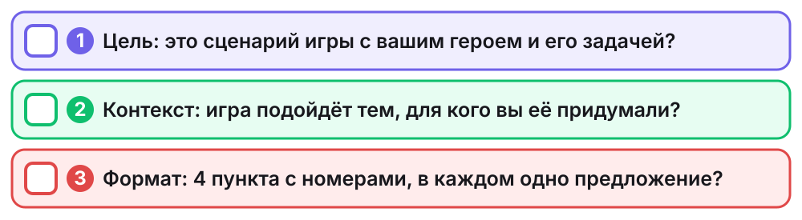

**Текст для учителя:**

Даже подробный промт не даёт гарантии: нейросеть может что-то пропустить или изменить. В справке Алисы AI прямо написано, что она может ошибаться. Поэтому проверяем ответ по нашим условиям.

**Это сценарий игры? Герой и его задача те, что вы написали?** Посчитайте пункты: **их ровно четыре? Есть начало, то, что мешает герою, то, как он справляется, и конец?**

**Всё совпало? Покажите один палец, если да, два, если что-то не так.** Искать ошибку любой ценой не нужно: если всё выполнено, это тоже результат проверки.

Теперь подумайте как автор игры. **Какой пункт вам хочется изменить?** Покажите его номер, сейчас он пригодится.

**Действие:** пройти по трём вопросам, показать один или два пальца, выбрать пункт для изменения и показать его номер.

### Слайд 18. Шаг 5. Уточняем в том же чате

**Время:** 41–44.

**На экране:** образец уточнения и схема с петлёй от уточнения к новому ответу.

Образец: *Измени пункт [номер]: [что должно быть в нём]. Остальные пункты оставь как есть. Напиши весь сценарий целиком.*

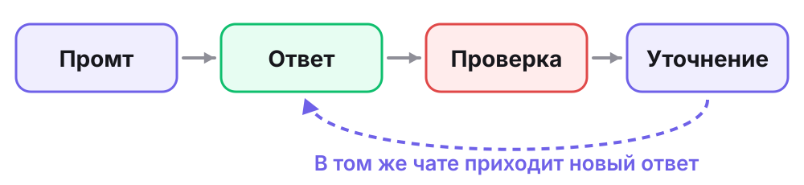

**Текст для учителя:**

Первый ответ не обязан быть последним. Заново всё объяснять не нужно: пишем в тот же чат, в нём сохраняется наш разговор.

Образец в чате урока. Напишите номер пункта и что должно быть в нём. Например: «Измени пункт 2: герою мешает песчаная буря. Остальные пункты оставь как есть. Напиши весь сценарий целиком». Скобки сотрите.

Прочитайте новый ответ. **Пункт изменился? А остальные пункты остались прежними?** Если нейросеть изменила что-то лишнее, напишите ей об этом ещё раз.

**Что поменялось в вашем сценарии?** Напишите в чат урока одно-два слова или скажите голосом.

**Действие:** отправить уточнение в тот же чат, проверить результат, сказать, что поменялось.

Промт для чата урока: `Измени пункт [номер]: [что должно быть в нём]. Остальные пункты оставь как есть. Напиши весь сценарий целиком.`

### Слайд 19. Шаг 6. Сохраняем сценарий

**Время:** 44–46.

**На экране:** схема копирования значком из двух квадратов и подпись «Скопируйте последний ответ со сценарием и вставьте его в чат урока».

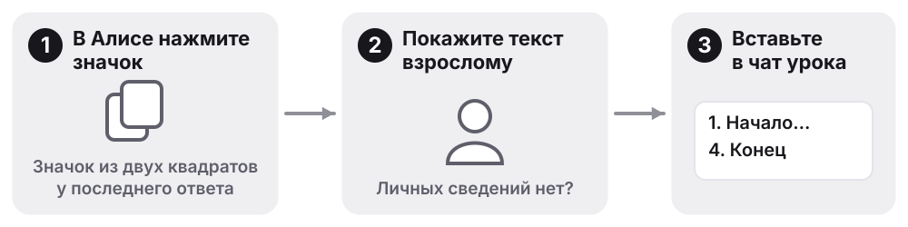

**Текст для учителя:**

Сохраним сценарий сразу, пока этот чат открыт. Найдите значок из двух квадратов: он копирует ответ. Нажмите его у последнего ответа со сценарием и вставьте текст в чат урока. Если не получается, позовите взрослого.

**Сценарий у всех в чате урока?** Покажите большой палец.

*Для преподавателя: сохраните присланные сценарии в материалы ученика. Без подключённой опции Алиса Плюс история в чате Алисы хранится 14 дней, поэтому на неё полагаться нельзя. Перед сохранением проверьте, что в тексте нет личных сведений.*

**Действие:** скопировать сценарий и вставить в чат урока. Помогает взрослый.

### Слайд 20. Пауза для глаз и плеч

**Время:** 46–48. Интерактивная пауза.

**На экране:** схема «от экрана вдаль» и три действия:

1. Посмотрите вдаль.
2. Поднимите и опустите плечи.
3. Потянитесь.

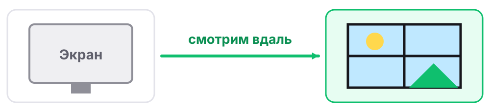

**Текст для учителя:**

Вы хорошо поработали, дадим отдых глазам. Отведите взгляд от экрана и посмотрите на самый дальний предмет в комнате или в окно. Считаю до десяти.

Спокойно поднимите плечи и опустите. Ещё раз. Потянитесь вверх, если удобно. Можно делать это сидя.

**Готовы продолжать?** Покажите большой палец. Сейчас будет самое сложное задание: образца больше нет.

**Действие:** выполнить три движения, показать большой палец.

### Слайд 21. Шаг 7. Свой промт без образца

**Время:** 48–53.

**На экране:** задание «У игры должно быть название. Напишите промт сами» и три пустые части промта с подсказками. Внизу напоминание: «Новый чат. Личные сведения не пишем».

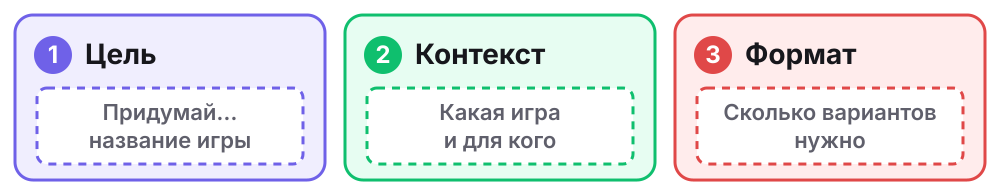

**Текст для учителя:**

У вашей игры пока нет названия. Попросите Алису его придумать, но теперь промт вы пишете полностью сами.

Начните новый чат. Это тренировка: напишите промт так, чтобы он был понятен без прошлого разговора. Поэтому об игре придётся рассказать в самом промте.

Проверьте себя тремя вопросами: что сделать, про что, какой нужен ответ. **Сколько названий вы хотите получить на выбор?**

Отправьте промт. Выберите название, которое вам нравится больше всего. Если ни одно не подошло, уточните в том же чате, какое название вам нужно. Выбранное название напишите в чат урока.

*Для преподавателя: образец показывайте только тому, кто застрял: «Придумай название для игры про робота Болта, который чинит ракету. Напиши 3 варианта». Если какой-то части нет, спросите: «На какой вопрос здесь нет ответа?», а не подсказывайте слова.*

**Действие:** самостоятельно написать и отправить промт, выбрать название, написать его в чат урока. Трудно печатать? Продиктуйте взрослому: промт всё равно ваш.

### Слайд 22. Показываем результат

**Время:** 53–55.

**На экране:** три подсказки к рассказу.

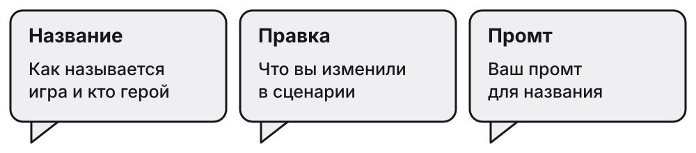

**Текст для учителя:**

Покажем, что получилось. Расскажите, как называется игра и кто в ней герой. Затем скажите, что вы изменили в сценарии, и прочитайте свой промт для названия.

**Кто готов рассказать первым?** Остальные слушают и потом отвечают на один вопрос. Я назову слова из этого промта, а вы скажете: **на какой из трёх вопросов они отвечают?**

Обсуждаем промт, а не красоту сценария. Вы сегодня были авторами: героя, задачу и правки выбрали вы.

**Действие:** двое детей рассказывают, по 30–40 секунд. Остальные показывают номер части пальцами. На индивидуальном занятии рассказывает ученик, преподаватель находит три части в его промте, а ученик проверяет.

---

## Блок 5. Итоги и домашнее задание (55–60)

### Слайд 23. Проверим себя

**Время:** 55–57.

**На экране:** три вопроса. Ответы открываются после обсуждения.

1. На какие три вопроса отвечает промт? *(Что сделать? Про что? Какой нужен ответ?)*
2. Почему на короткий промт приходит неожиданный ответ? *(Нейросеть не знает задумку и выбирает сама.)*
3. «Придумай игру. Напиши 3 пункта». Какой части не хватает? *(Второй: неизвестно, про что игра.)*

**Текст для учителя:**

Подсказок больше нет. **На какие три вопроса отвечает промт?** Покажите на пальцах и назовите.

**Почему на короткий промт приходит неожиданный ответ?** Ответьте своими словами, вспомните торт или вашу игру.

**«Придумай игру. Напиши 3 пункта». Какой части не хватает?** Покажите номер пальцами. Второй: неизвестно, про что игра. **А как её дописать?** Например: «про кота, который ищет клад».

**Действие:** ответить голосом, пальцами или в чате.

### Слайд 24. Что получилось

**Время:** 57–58.

**На экране:** три ступени самооценки и начало фразы «В следующем промте не забыть…».

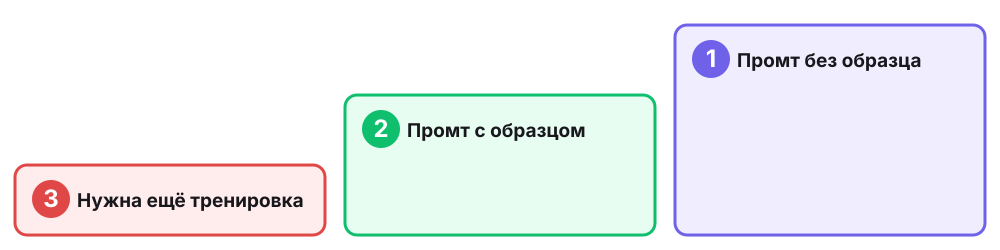

**Текст для учителя:**

Вернёмся к началу. Посмотрите на список из цели: вы выбирали пункт, который хотелось попробовать первым. **Получилось?** И ещё один вопрос. **Какой промт вам сейчас по силам?** Покажите номер пальцами. Оценок за это нет.

**Закончите фразу: «В следующем промте не забыть…»** Скажите голосом: например, «сказать, какой длины ответ».

**Действие:** показать номер пальцами, закончить фразу голосом. Выбравшие третий номер пишут в чат одно слово: что осталось трудным. Преподаватель учитывает это на следующем уроке.

### Слайд 25. Домашнее задание: «Нарисуй по промту»

**Время:** 58–59.

**На экране:** подпись «Около 15 минут», пример двух рисунков и три шага:

1. Загадайте зверя и не называйте его. Скажите близкому короткий промт: «Нарисуй зверя».
2. На новом листе пусть нарисует по подробному промту из трёх частей про вашего зверя.
3. Сравните рисунки. Какой ближе к вашей задумке?

Красная заметка «Что прислать»: фото двух рисунков и одна фраза о том, что получилось.

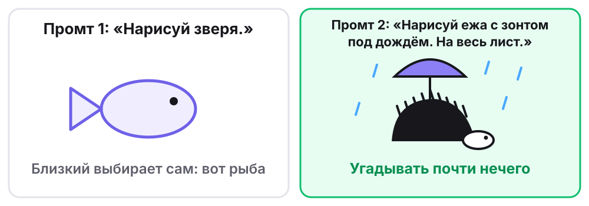

**Текст для учителя:**

Дома вы снова поиграете в нейросеть с близкими. Вы автор промта, а близкий человек рисует. Компьютер и Алиса не нужны, только бумага и карандаш.

Загадайте зверя и никому его не называйте. Сначала скажите короткий промт: «Нарисуй зверя». Потом подробный: какого зверя нарисовать, что с ним происходит и каким должен быть рисунок. Сравните два рисунка.

Пришлите в чат урока фото рисунков и одну фразу: что изменилось, когда промт стал подробным. На фото только рисунки.

**Какой промт вы скажете первым?** Правильно, короткий.

**Действие:** ответить на вопрос, спросить, если что-то непонятно. Рядом никого нет? Можно поиграть по видеосвязи. Фото можно заменить устным рассказом на следующем занятии.

### Слайд 26. До встречи!

**Время:** 59–60.

**На экране:** зелёный финальный слайд дизайнбука: «До встречи на следующем уроке!» и строка «Текстовый промтинг, часть 2: роль и образец в промте, проверка фактов».

**Текст для учителя:**

Сегодня вы написали промт из трёх частей, проверили ответ и уточнили его. У вашей игры теперь есть сценарий и название.

На следующем уроке мы продолжим: научимся давать нейросети роль, показывать образец и проверять факты в ответе. **Что вы расскажете дома об этом уроке одной фразой?**

Спасибо за работу! До встречи!

**Действие:** сказать одну фразу о сегодняшнем уроке, попрощаться.

---

## Запасной план, если Алиса AI недоступна

Эти тексты написаны заранее и не получены от Алисы AI. Скажите об этом детям прямо. Настоящие запросы перенесите на следующее занятие.

**Слайд 14, промт «Придумай игру»:** «Игра “Собери яблоки”. Игрок ходит по саду и собирает яблоки. За каждое яблоко он получает очко. Игра заканчивается, когда яблоки закончились».

**Слайды 15–17, образец про робота Болта.** В ответе специально нет одного пункта, чтобы проверка нашла, что исправить:

1. Начало: робот Болт находит сломанную ракету.
2. Что мешает: детали разбросаны по всей планете.
3. Конец: ракета взлетает, и Болт машет всем рукой.

**Слайд 18.** Здесь уточнение другое, объявите это детям: «Добавь пункт: как герой справляется. Остальные пункты оставь как есть. Напиши весь сценарий целиком». Учебный ответ:

1. Начало: робот Болт находит сломанную ракету.
2. Что мешает: детали разбросаны по всей планете.
3. Как справляется: Болт собирает детали с помощью магнита.
4. Конец: ракета взлетает, и Болт машет всем рукой.

**Слайды 19 и 21.** Ребёнок пишет свои промты в чат урока, преподаватель проверяет в них три части. Отправка в Алису AI и сохранение сценария переносятся на следующее занятие.

## Источники для преподавателя

Страницы проверены 3 ноября 2026 года. Интерфейс и правила сервиса могут измениться, поэтому перед занятием проверьте их снова.

- [Условия использования сервиса «Алиса AI»](https://yandex.ru/legal/alice_chat/), п. 1.7: использование несовершеннолетним, контроль законного представителя. Минимальный возраст в условиях не указан.
- [Алиса AI: как писать запросы](https://alice.yandex.ru/support/ru/assistant/chat/how-write-prompts.md): «определите цель», «задайте контекст», «укажите формат ответа», «не бойтесь уточнять и корректировать полученные ответы».
- [Алиса AI: создание текста](https://alice.yandex.ru/support/ru/assistant/chat/text): «чем детальнее запрос, тем лучше результат», «в чате сохраняется контекст беседы», «Алиса AI старается, но может ошибаться», копирование ответа значком из двух квадратов.
- [Алиса AI: чат](https://alice.yandex.ru/support/ru/assistant/chat-alice.md): «беседы не будут смешиваться друг с другом», значок нового чата, срок хранения истории.
- [Google: введение в большие языковые модели](https://developers.google.com/machine-learning/resources/intro-llms): языковая модель предсказывает следующий кусочек текста.
