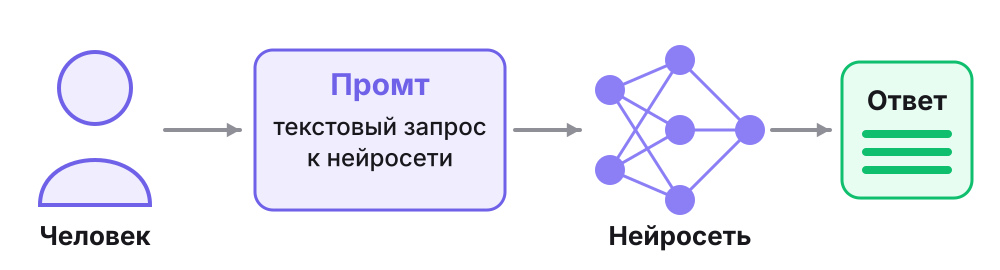
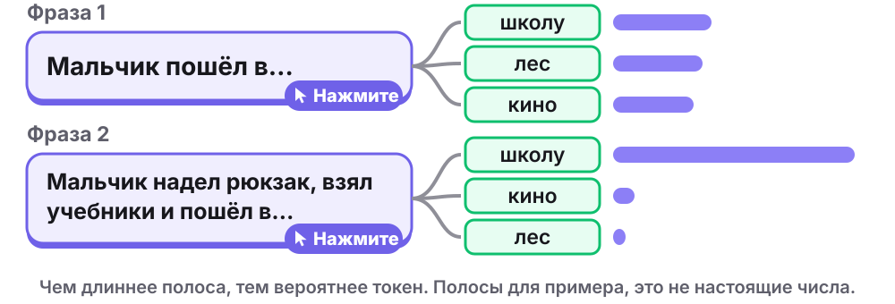
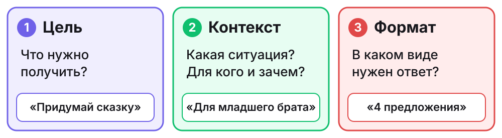

# Текстовый промтинг. Часть 1

Модуль «Нейросети и AI-проекты», урок 2. Сценарий презентации для онлайн-урока: 7–9 лет, 60 минут, Zoom или Телемост. Дети видят только слайды. Спикерскую речь видит только преподаватель.

**Вопросы детям выделены жирным.** Речь написана на «вы» и подходит для группы и для одного ученика. Что меняется на индивидуальном занятии, указано в строке «Действие».

## Расписание

| Время | Блок | Слайды | Минут |
|---|---|---|---|
| 00–05 | Приветствие, план и цель | 1–3 | 5 |
| 05–10 | Домашнее задание и повторение первого урока | 4 | 5 |
| 10–27 | Новая тема с разминкой внутри | 5–12 | 17 |
| 27–55 | Практика в Алисе AI: мини-проект «Сценарий игры» | 13–22 | 28 |
| 55–60 | Итоги и домашнее задание | 23–26 | 5 |

Интерактивные паузы:

| Минута | Что происходит | Слайд |
|---|---|---|
| 05–10 | Рассказ о домашнем задании и «Верно или неверно» | 4 |
| 14–16 | Вопрос про кондитера | 7 |
| 16–19 | Разминка «Живой промт» | 8 |
| 23–26 | Поиск недостающей части промта | 11 |
| 27–47 | Практика: действие и ответ каждые 2–5 минут | 13–19 |
| 47–48 | Пауза для глаз и плеч | 20 |
| 48–55 | Свой промт и показ результата | 21–22 |

## Подготовка преподавателя

**Согласие и взрослый рядом**

- Условия сервиса (п. 1.7) допускают использование несовершеннолетним «с ведома и согласия его законного представителя и под его контролем». Законный представитель сам знакомится с условиями и принимает их. Получите его согласие до урока.
- В том же пункте сказано, что Яндекс «не гарантирует отсутствие в Сервисе информации, не соответствующей возрастной категории». Поэтому на время практики взрослый сидит рядом: контролирует, помогает читать и копировать. Решения принимает ребёнок.
- Если нужен вход, его выполняет взрослый. Он же отключает персонализацию, если такая настройка есть. Пароль детям не передаётся.
- Нет согласия или взрослого рядом? Ребёнок не работает в Алисе AI, а пишет промты в чат урока по запасному плану.

**Проверка сервиса за день до урока**

- Отправьте все промты урока в [Алису AI](https://alice.yandex.ru). Ответы заранее неизвестны и каждый раз могут отличаться.
- На устройстве ребёнка проверьте, открывается ли сайт и создаётся ли второй чат. Можно ли вернуться в первый чат? Если нет, второй чат открывайте в новой вкладке.
- Найдите кнопку нового чата (в справке это значок в виде облака с плюсом) и кнопку копирования (значок из двух квадратов). Интерфейс может измениться, поэтому при необходимости замените значки на слайдах 13 и 19.

**Техника на уроке**

- Лучше один компьютер: видеосвязь и Алиса AI в двух окнах. На телефоне или планшете переключаться между окнами трудно. Если Алиса AI открыта на втором устройстве, подключите его к той же встрече без звука и микрофона, чтобы на нём был чат урока.
- Попросите взрослого открыть сайт заранее, до начала практики.
- Заранее пришлите в чат урока ссылку на сайт и подготовьте промты со слайдов 15 и 18. Детям трудно быстро печатать, поэтому они копируют образец и заменяют слова в скобках. Проверьте, вставляется ли в чат вашей видеосвязи текст длиной со сценарий. До выхода из встречи сохраните присланные сценарии: чат может пропасть.
- Дети смотрят на слайд и работают в другом окне, поэтому каждый шаг практики читайте вслух.
- Камера выключена? Ребёнок отвечает цифрой в чат или реакцией вместо жеста.
- Если ответ не приходит больше минуты, пусть ребёнок обновит страницу и отправит промт снова.
- Если Алиса AI недоступна, используйте запасной план из конца документа и прямо скажите, что ответы написаны заранее.
- Заранее предупредите родителей: для домашнего задания нужен взрослый рядом и доступ к Алисе AI.

**Показ слайдов.** Интерактив только прямо на слайде, и нажимается только то, что приподнято: у такого элемента есть цветной нижний край. Кнопки-ответы с тёмным краем на слайдах 4, 6, 7, 8, 9, 11 и 12: нажмите ответ, и появится результат. Элементы с меткой «Нажмите» на слайдах 6, 8, 10, 14 и 23: нажмите на фразу, карточку, строку или вопрос, и появится продолжение, а метка исчезнет. Повторное нажатие ничего не скрывает. При перелистывании всё сбрасывается.

## Что входит в урок и что остаётся на часть 2

В уроке: что такое промт, зачем нужны подробности, три части промта, проверка ответа по условиям, уточнение в том же чате.

На часть 2: роль, образец в промте, разбивка задачи на шаги, проверка фактов по источнику.

Сценарий игры выдуман, поэтому фактов в нём проверять не нужно: дети проверяют только, выполнена ли их просьба. Мини-проект «Сценарий игры» указан в программе модуля, там же есть постер и трейлер к игре.

Части промта называются настоящими терминами из справки Алисы AI: цель, контекст, формат. Детям они объясняются простыми словами на слайде 9. Откуда взято каждое теоретическое утверждение, показано в разделе «Карта теории» в конце документа.

---

## Блок 1. Приветствие, план и цель (00–05)

### Слайд 1. Текстовый промтинг. Часть 1

**Время:** 00–02.

**На экране:** заголовок и подзаголовок «Как написать хороший запрос к нейросети». Ниже цветные плашки: цель, контекст, формат и стрелка к слову «Ответ».

**Текст для учителя:**

Здравствуйте! Если меня хорошо слышно, покажите большой палец.

Начнём с маленькой истории. Представьте, что вы просите друга: «Принеси что-нибудь вкусное». **Как думаете, что он принесёт? Это будет именно то, чего вам хотелось?** Он может принести яблоко, конфету или бутерброд. Друг старался, но о вашем желании он знал мало.

Запрос к нейросети тоже можно написать так, что она узнает слишком мало. Сегодня разберём три первых совета из инструкции Алисы, как написать хороший запрос. А во второй половине урока вы вместе с Алисой AI придумаете сценарий своей игры.

**Действие:** показать большой палец. Назвать голосом или написать в чат, что принесёт друг.

### Слайд 2. Как пройдут 60 минут

**Время:** 02–03.

**На экране:** подпись «Agenda · план занятия», заголовок «Как пройдут 60 минут» и компонент agenda из дизайнбука, пять строк:

- **0–5.** Начало: план и цель урока.
- **5–10.** Повторение: домашнее задание и прошлый урок.
- **10–27.** Новая тема: промт, токен, цель, контекст и формат, разминка.
- **27–55.** Практика: сценарий игры в Алисе AI.
- **55–60.** Итоги: что получилось и домашнее задание.

**Текст для учителя:**

Вот наш план. Сначала вспомним первый урок, потом разберём новую тему и разомнёмся. Больше всего времени займёт практика: там работаете вы, а я помогаю. В конце подведём итоги, и я расскажу о домашнем задании.

**Действие:** посмотреть план и показать большой палец, если всё понятно.

### Слайд 3. Цель урока

**Время:** 03–05.

**На экране:** подпись «Цель · что будет в конце», блок ek-note с формулировкой и две карточки grid-2.

Формулировка цели: *Составлять промт из трёх частей: цель, контекст, формат. Проверять ответ нейросети по этим частям и уточнять его в том же чате.*

Карточка **Узнаете:**

- Что такое промт и токен
- Как нейросеть выбирает следующий кусочек текста
- Что такое цель, контекст и формат промта
- Зачем промт уточняют несколько раз

Карточка **Сделаете:**

- Найти недостающую часть промта
- Сравнить ответы на короткий и подробный промт
- Составить сценарий игры в Алисе AI
- Проверить ответ по частям промта
- Уточнить ответ в том же чате
- Написать промт без образца

**Текст для учителя:**

Прочитаю цель урока. Составлять промт из трёх частей: цель, контекст, формат. Проверять ответ нейросети по этим частям и уточнять его в том же чате.

Слова «промт», «контекст» и «формат» пока могут быть незнакомыми. Через несколько минут вы будете ими пользоваться. Слева то, что вы узнаете, справа то, что сделаете. Итог практики: сценарий вашей игры. Мы его сохраним, он ещё пригодится в этом модуле.

**Какой пункт в правой карточке вам хочется попробовать первым?** Назовите его или напишите в чат. В конце урока мы к этому списку вернёмся.

**Действие:** назвать пункт голосом или в чате.

---

## Блок 2. Повторение (05–10)

### Слайд 4. Домашнее задание и «Верно или неверно»

**Время:** 05–10. Интерактивная пауза.

**На экране:** заголовок и пять утверждений с первого урока. У каждого две кнопки: «Верно» и «Неверно». Учитель нажимает ответ, и кнопка показывает результат: зелёная с галочкой, если ответ правильный, красная с крестиком, если нет. Внизу вопрос о домашнем задании.

1. Нейросеть обучают на примерах. *(верно)*
2. Нейросеть всегда знает ответ наверняка. *(неверно)*
3. Если в примерах все семёрки зелёные, нейросеть может принять зелёную единицу за семёрку. *(верно)*
4. Если написать в чате «сделай короче», нейросеть обучается заново. *(неверно)*
5. В чат можно писать свой домашний адрес. *(неверно)*

**Текст для учителя:**

Сначала о домашнем задании. **Что вы создали дома с Алисой? Что попросили изменить?** Послушаем одного человека. Присланные работы я посмотрю после урока. Не было доступа к Алисе дома? Ничего страшного, сегодня на практике вы с ней поработаете.

Теперь вспомним прошлый урок. Я читаю утверждение, вы отвечаете, а я нажимаю ваш ответ на экране.

**Нейросеть обучают на примерах. Верно или неверно?** Верно: ей показывают множество примеров с подписями.

**Нейросеть всегда знает ответ наверняка. Верно или неверно?** Неверно. Она оценивает, что больше подходит, поэтому на необычном примере может ошибиться.

**Если в примерах все семёрки зелёные, нейросеть может принять зелёную единицу за семёрку. Верно или неверно?** Верно. Помните этот случай? Она могла опереться на цвет, а не на форму цифры.

**Если написать в чате «сделай короче», нейросеть обучается заново. Верно или неверно?** Неверно. Её обучают разработчики до нашего разговора. А мы уточняем просьбу и получаем другой ответ.

**В чат можно писать свой домашний адрес. Верно или неверно?** Неверно. Телефон, адрес и пароль оставляем при себе. Это правило действует и сегодня.

**Действие:** один ребёнок рассказывает о домашнем задании. На каждое утверждение дети отвечают голосом или в чате, учитель нажимает названный ответ на слайде. Кто ошибся, ничего страшного: сразу разбираем.

---

## Блок 3. Новая тема (10–27)

### Слайд 5. Что такое промт

**Время:** 10–12.

**На экране:** заголовок и определение «Промт — текстовый запрос, по которому нейросеть составляет ответ». Схема: человек, промт, нейросеть, ответ.

**Текст для учителя:**

На прошлом уроке вы писали Алисе запросы. Такой запрос называют промтом. В инструкции Алисы написано так: промт — это текстовый запрос, на основе которого она составляет ответ. Составление таких запросов называют промтингом. Создатели нейросети Gemini пишут: промты составляют так, чтобы получать точные и качественные ответы.

Посмотрите на схему. Человек пишет промт, нейросеть составляет ответ. Многое она умеет благодаря обучению. Но о вашей задумке она не знает, пока вы не напишете о ней в промте.

**Что вы просили у Алисы на прошлом уроке?** Вспомните один свой запрос. Вот это и был промт.

**Действие:** назвать один свой запрос с прошлого урока. Не помните? Можно назвать то, о чём хотелось бы спросить.

### Слайд 6. Какое слово дальше?

**Время:** 12–14.

**На экране:** заголовок, определение «Токен — кусочек текста: слово, часть слова или даже одна буква» и две фразы с меткой «Нажмите». Учитель нажимает на фразу, и появляются её продолжения с полосами. Внизу вопрос «В какой фразе больше подсказок?» с кнопками «Фраза 1» и «Фраза 2». После верного ответа появляется пояснение.

**Текст для учителя:**

На прошлом уроке мы говорили, что нейросеть составляет текст по кусочкам. Например: «Кот залез на…». Теперь узнаем об этом больше. У такого кусочка есть название: токен. Это может быть слово, часть слова или даже одна буква. Нейросеть оценивает, насколько вероятен каждый следующий токен, то есть насколько он ожидаем после этих слов, и выбирает подходящий. Попробуйте сами побыть на её месте.

**Мальчик пошёл в… Какое слово дальше?** Скажите или напишите в чат. Нажимаю на фразу. Подходит многое: в школу, в лес, в кино.

**А теперь: мальчик надел рюкзак, взял учебники и пошёл в… Какое слово дальше?** Нажимаю на фразу. Чаще всего скажут «в школу». Рюкзак и учебники подсказали.

Такие полезные сведения рядом с нужным словом называются контекстом. Создатели нейросетей пишут, что контекст помогает модели предсказывать лучше. **В какой фразе больше подсказок?** Нажимаю ваш ответ. Во второй: там контекста больше. Запомните это слово, сейчас оно понадобится.

*Для преподавателя: это новая тема. На первом уроке было только «по кусочкам», слов «токен», «вероятность» и «контекст» там не было. Длина полос условная, модель мы не запускали. Это общий принцип языковых моделей, подробности устройства Алисы AI разработчик не описывает.*

**Действие:** договорить обе фразы голосом или в чате, ответить, где больше подсказок. Учитель нажимает на фразы и на названный ответ.

### Слайд 7. Умный новичок

**Время:** 14–16. Интерактивная пауза.

**На экране:** заголовок и строка «Создатели нейросети Claude советуют представить её как умного, но нового сотрудника». Схема: короткий заказ и три разных торта, подробный заказ и один торт. Внизу вопрос «Кондитер ошибся?» с кнопками «Да» и «Нет». После верного ответа появляется пояснение.

**Текст для учителя:**

Создатели нейросети Claude предлагают такое сравнение. Представьте нейросеть как умного, но нового сотрудника. Работать он умеет, а о ваших правилах и о том, как у вас всё устроено, ещё не знает. Чем точнее вы объясните, что вам нужно, тем лучше будет результат. Это сравнение, настоящая нейросеть устроена не как человек.

Возьмём нового кондитера. Ему пишут: «Испеките торт». Посмотрите на три торта слева: каждый подходит под заказ. Заказчик ждал шоколадный торт на день рождения, а получил белый с зелёной волной. **Кондитер ошибся?** Нажимаю ваш ответ. Нет: заказ он выполнил, а чего хотел заказчик, не знал.

Теперь справа: «Испеките шоколадный торт на день рождения. Круглый, с семью свечами». **Что теперь решил заказчик, а не кондитер?** Вкус, повод, форму и число свечей.

В инструкции Алисы про промт сказано похоже: чем подробнее он сформулирован, тем лучше будет результат.

**Действие:** ответить, ошибся ли кондитер (учитель нажимает ответ), назвать, что решил заказчик.

### Слайд 8. Разминка «Живой промт»

**Время:** 16–19. Интерактивная пауза с движением.

**На экране:** строка «Проверка промта: поймёт ли его тот, кто не знает задумку?» и две одинаковые белые карточки с просьбами и меткой «Нажмите». Рисунки сначала скрыты, чтобы дети выполняли слова, а не копировали позу. Учитель нажимает на карточку после показа детей, и появляются фигурки с подписью, а вторая карточка становится зелёной. Внизу вопрос с кнопками «Первый» и «Второй». После верного ответа появляется пояснение.

**Текст для учителя:**

Разомнёмся и заодно попробуем настоящий способ проверки. Создатели Claude советуют показать промт человеку, который почти ничего не знает о задаче, и попросить его выполнить. Они пишут: запутается человек, запутается и Claude. Сейчас этот человек — вы. Встаньте, если рядом свободно. Можно делать всё сидя.

Первый промт: «Покажите животное». Покажите! Я задумал(а) кота. Показали другое животное? Это нормально: вы выполнили просьбу правильно, а мою задумку угадать не могли. Нажимаю на карточку: вариантов много.

Второй промт: «Покажите зайца: две руки вверх, это уши. Пошевелите ими 3 раза». Покажите! Нажимаю на карточку: теперь совпало с задумкой.

Третий промт придумайте вы. **Какое животное показать и что сделать?** Теперь выполняю я. Если вас несколько, повторяйте за мной.

Садимся удобно. **В каком промте вы точно знали, что показать?** Нажимаю ваш ответ. Во втором: в нём сказано, что именно нужно сделать.

Это проверка на людях. Нейросеть устроена не как человек, но совет создателей именно такой.

**Действие:** показать животное, затем зайца. Один ребёнок придумывает третий промт, остальные его выполняют. На индивидуальном занятии третий промт придумывает ученик, а выполняет преподаватель.

### Слайд 9. Три части промта

**Время:** 19–21.

**На экране:** заголовок и три цветные карточки: цель, контекст, формат. У каждой номер, простое объяснение и пример. Эти цвета и номера закреплены за частями промта до конца урока. Внизу вопрос с кнопками «Цель», «Контекст», «Формат». После верного ответа появляется пояснение.

**Текст для учителя:**

В инструкции Алисы первыми идут три совета, как писать промт. Определите цель, задайте контекст, укажите формат ответа. Это три настоящих слова, и сейчас мы их разберём. Повторяйте за мной и загибайте пальцы.

Цель: что именно вам нужно получить. Там сказано: чем конкретнее цель, тем конкретнее ответ. В инструкции советуют вместо «Расскажи мне о космосе» просить о чём-то одном: например, объяснить, как работают чёрные дыры.

Контекст: какая у вас ситуация, для кого это и зачем нужно. Так нейросети легче подобрать, как сказать: весело или серьёзно, просто или сложнее. На слайде с рюкзаком контекстом были полезные слова рядом. В промте контекстом мы называем сведения о вашей ситуации.

Формат: в каком виде нужен ответ. Короткий ответ, список, таблица или что-то ещё.

В инструкции есть и другие советы, а эти три самые первые. Порядок в промте может быть другим.

**Возьмём заказ покороче: «Испеките торт на день рождения». Какая часть здесь «на день рождения»?** Нажимаю ваш ответ. Контекст: это ситуация.

**Действие:** повторить за преподавателем цель, контекст и формат, загибая пальцы. Назвать часть для слов «на день рождения», учитель нажимает ответ.

### Слайд 10. Разбираем промт

**Время:** 21–23.

**На экране:** промт из трёх одинаковых белых строк с меткой «Нажмите», чтобы цвет не подсказывал ответ. Учитель нажимает на строку, она получает цвет своей части, и рядом появляется название. Внизу вопрос про другой контекст.

**Текст для учителя:**

Посмотрим на целый промт: «Придумай сказку про ежа, который боится темноты. Я прочитаю её младшему брату перед сном. Напиши 4 предложения».

**Где здесь цель?** Нажимаю на строку: «Придумай сказку про ежа, который боится темноты». **Где контекст?** «Я прочитаю её младшему брату перед сном». **Где формат?** «Напиши 4 предложения».

Заметьте: особых слов не нужно. Это обычная понятная просьба, просто в ней сказано всё важное.

**Что может измениться в ответе, если вместо младшего брата написать «для взрослых на празднике»?** Контекст другой, поэтому могут измениться слова и тон сказки.

**Действие:** назвать слова из промта для каждой части голосом или в чате. Учитель нажимает на названную строку.

### Слайд 11. Какой части не хватает?

**Время:** 23–26. Интерактивная пауза.

**На экране:** три промта. У каждого три кнопки: «Цель», «Контекст», «Формат». Учитель нажимает ответ, и кнопка показывает результат. Внизу вопрос о том, как дополнить промт Б.

- А: «Придумай стихотворение про осень. Это для школьного праздника». *(нет формата)*
- Б: «Придумай стихотворение про осень. Напиши 4 строки». *(нет контекста)*
- В: «Это для школьного праздника. Напиши 4 строки». *(нет цели)*

**Текст для учителя:**

Теперь проверяете вы. В каждом промте пропала одна часть. Назовите, какая, а я нажму ваш ответ.

**А: «Придумай стихотворение про осень. Это для школьного праздника». Какой части нет?** Формата: неизвестно, какой длины и в каком виде стихотворение.

**Б: «Придумай стихотворение про осень. Напиши 4 строки». Какой части нет?** Контекста: неизвестно, для кого и зачем.

**В: «Это для школьного праздника. Напиши 4 строки». Какой части нет?** Цели: непонятно, что сделать. Стихотворение? Поздравление? Загадку?

**Как дополнить промт Б?** Например: «Это для школьного праздника».

**Действие:** на каждый промт назвать недостающую часть голосом или в чате, учитель нажимает ответ. Один ребёнок дополняет промт Б устно.

### Слайд 12. Формат: говорим точно

**Время:** 26–27.

**На экране:** вопрос «Какое условие легко проверить?» и две большие кнопки-карточки: «Напиши хорошо» и «Напиши 3 предложения». Учитель нажимает ответ, и появляются значки «? ? ?» и «1 · 2 · 3» и пояснение.

**Текст для учителя:**

Ещё про формат. Создатели нейросети Claude советуют говорить точно, какой результат вам нужен. **Какое условие легко проверить: «напиши хорошо» или «напиши 3 предложения»?** Нажимаю ваш ответ. Второе: предложения можно посчитать, а слово «хорошо» каждый понимает по-своему.

*Для преподавателя: совет говорить точно взят из инструкции Anthropic. Проверка подсчётом — приём этого урока, в инструкциях такого правила нет.*

**Действие:** выбрать условие, учитель нажимает ответ.

---

## Блок 4. Практика: мини-проект «Сценарий игры» (27–55)

### Слайд 13. Начинаем практику

**Время:** 27–29.

**На экране:** заголовок, строка «Сценарий — это рассказ о том, что происходит в игре: начало, трудности, конец» и схема из трёх шагов. Ниже три подсказки: «Ссылка в чате урока. Пока ничего не отправляем», «Просят войти или ввести личные сведения? Позовите взрослого», «Ответ странный или неприятный? Покажите взрослому».

**Текст для учителя:**

Теперь работаете вы, а я помогаю. Сегодня вы придумаете сценарий своей игры. Сценарий — это рассказ о том, что в игре происходит: как она начинается, что мешает герою и чем всё заканчивается. Сначала посмотрим, что выйдет с коротким промтом, потом напишем подробный и сравним.

Ссылка на сайт есть в чате урока. Откройте Алису AI и начните новый чат. Найдите поле, куда пишут сообщение. Пока ничего не отправляем.

Если сайт просит войти или ввести личные сведения, позовите взрослого. Если ответ покажется странным или неприятным, покажите его взрослому.

**Взрослый рядом с вами? Чат открылся?** Покажите большой палец. Что-то не открывается? Напишите мне в чат урока.

**Действие:** открыть сайт, начать новый чат, показать большой палец. Преподаватель вставляет ссылку в чат урока в начале слайда.

### Слайд 14. Шаг 1. Короткий промт

**Время:** 29–32.

**На экране:** команда «Напишите в новом чате два слова. Отправьте. Дождитесь ответа» и промт «Придумай игру.». На промте метка «Нажмите». После ответа Алисы учитель нажимает на промт, и рядом появляется разбор по частям. Внизу вопрос.

**Текст для учителя:**

Напишите ровно два слова: «Придумай игру». Отправьте и дождитесь ответа. Если трудно читать, попросите взрослого прочитать вслух.

**Что Алиса решила за вас? Какую игру она выбрала? Есть ли там герой?** Напишите в чат одно-два слова или скажите голосом.

Нажимаю на промт. Цель здесь общая, контекста и формата нет. Алиса переспросила или предложила несколько игр? Это тоже понятно: вашей задумки она не знает. Если ответ вам понравился, это нормально: на короткий промт иногда приходит удачный ответ. Но выбирала всё равно нейросеть, а не вы.

И ещё. На один и тот же промт ответы могут отличаться: нейросеть не всегда берёт самый вероятный токен, иногда случайно выбирает из подходящих. Поэтому у другого человека могла бы получиться другая игра.

Запомните этот ответ, сейчас мы его сравним с новым.

*Для преподавателя: случайность в выборе токенов — общий принцип языковых моделей. Настройки именно Алисы AI разработчик не описывает.*

**Действие:** отправить промт, прочитать ответ, назвать одну вещь, которую нейросеть решила сама.

### Слайд 15. Шаг 2. Промт из трёх частей

**Время:** 32–37.

**На экране:** команда «Начните новый чат. Скопируйте образец из чата урока, замените слова в скобках и сотрите скобки. Отправьте», образец промта по цвету частей и пример. Ниже подсказка «Герой выдуманный. Настоящие имена не пишем».

**Текст для учителя:**

Начните новый чат: так первый разговор не будет мешать. В инструкции Алисы сказано, что беседы из разных чатов не смешиваются. Если первый чат потом не найти, откройте новый в другой вкладке.

Образец уже в чате урока, скопируйте его в поле для промта. Теперь решите главное. **Кто будет героем вашей игры и какая у него задача? Для кого вы придумываете игру?** Герой должен быть выдуманным: настоящие имена и фамилии не пишем. Например, робот Болт, которому нужно починить ракету, а игра для друзей. У вас будет своё.

Вместо слов в скобках напишите своё. Скобки сотрите. Отправьте промт.

Пока идёт ответ, посмотрите на образец. **В какой части вы написали, для кого игра?** Покажите номер пальцами. Во второй: это контекст.

**Пришёл ответ?** Покажите большой палец.

**Действие:** начать новый чат, придумать героя, задачу и для кого игра, заменить слова в скобках, отправить. Взрослый помогает печатать, решения принимает ребёнок. Преподаватель вставляет промт в чат урока в начале слайда.

Промт для чата урока: `Придумай сценарий игры. Герой: [кто]. Его задача: [какая]. Я придумываю простую игру для [кого]. Напиши 4 пункта с номерами, в каждом одно предложение: 1 — начало, 2 — что мешает герою, 3 — как справляется, 4 — конец.`

### Слайд 16. Шаг 3. Сравниваем два ответа

**Время:** 37–39.

**На экране:** таблица по частям промта для двух промтов и вопрос.

**Текст для учителя:**

Прочитайте новый ответ. Вспомните первый: если он открыт в другой вкладке, посмотрите на него. **В каком ответе больше того, что задумали вы? Покажите один палец, если в первом, два, если во втором.**

Посмотрите на таблицу. Героя, задачу и то, для кого игра, решили вы. Длину вы не выбирали, она уже была в образце. Но теперь длину задаёт промт, и нейросети не надо выбирать её самой. Новый ответ не обязан быть красивее первого. Сравниваем другое: насколько он совпал с вашей задумкой.

**Действие:** сравнить ответы, показать один или два пальца.

### Слайд 17. Шаг 4. Проверяем ответ

**Время:** 39–41.

**На экране:** три вопроса по частям промта с пустыми квадратиками.

**Текст для учителя:**

И на подробный промт нейросеть может ответить с ошибкой: что-то пропустить или изменить. В инструкции Алисы прямо написано, что она может ошибаться. Поэтому проверяем ответ по частям нашего промта.

Цель: **это сценарий игры с вашим героем и его задачей?** Контекст: **такая игра подойдёт тем, для кого вы её придумали?** Формат: посчитайте пункты. **Их ровно четыре? Есть начало, то, что мешает герою, то, как он справляется, и конец? Номера есть? В каждом пункте одно предложение?**

**Всё совпало? Покажите один палец, если да, два, если что-то не так.** Искать ошибку любой ценой не нужно: если всё выполнено, это тоже результат проверки.

Теперь подумайте как автор игры. **Какой пункт сценария хочется изменить?** Покажите его номер, сейчас он пригодится.

**Действие:** пройти по трём вопросам, показать один или два пальца, выбрать пункт для изменения и показать его номер.

### Слайд 18. Шаг 5. Уточняем в том же чате

**Время:** 41–45.

**На экране:** образец уточнения с подписью «Образец в чате урока. Отправьте в тот же чат» и нейтральная схема с петлёй от уточнения к новому ответу. Подпись: «Промт иногда приходится улучшать за несколько попыток».

Образец: *Измени пункт [номер]: [что должно быть в нём]. Остальные пункты оставь как есть. Напиши весь сценарий целиком.*

**Текст для учителя:**

С первого раза идеальный ответ приходит не всегда, и это обычное дело. Создатели нейросети Gemini пишут, что промт иногда приходится улучшать за несколько попыток. В инструкции Алисы есть такой совет: не бойтесь уточнять и исправлять полученные ответы. Заново всё объяснять не нужно: пишем в тот же чат, в нём сохраняется наш разговор.

Образец в чате урока. Напишите номер пункта и что должно быть в нём. Например: «Измени пункт 2: герою мешает песчаная буря. Остальные пункты оставь как есть. Напиши весь сценарий целиком». Скобки сотрите.

Если какого-то пункта не хватает, напишите: «Добавь пункт: как герой справляется. Напиши весь сценарий целиком». Если номеров нет, напишите: «Пронумеруй пункты. Напиши весь сценарий целиком».

Прочитайте новый ответ. **Пункт изменился? А остальные пункты остались прежними?** Если нейросеть изменила что-то лишнее, напишите ей об этом ещё раз.

**Что поменялось в вашем сценарии?** Напишите в чат урока одно-два слова или скажите голосом.

**Действие:** отправить уточнение в тот же чат, проверить результат, сказать, что поменялось. Преподаватель вставляет образец в чат урока в начале слайда.

Промт для чата урока: `Измени пункт [номер]: [что должно быть в нём]. Остальные пункты оставь как есть. Напиши весь сценарий целиком.`

### Слайд 19. Шаг 6. Сохраняем сценарий

**Время:** 45–47.

**На экране:** строка «Скопируйте последний ответ со сценарием и вставьте его в чат урока» и схема из трёх действий: в Алисе нажать значок из двух квадратов, показать текст взрослому, вставить в чат урока. На слайде эти значки не нажимаются.

**Текст для учителя:**

Сохраним сценарий сразу, пока этот чат открыт. Найдите значок из двух квадратов: он копирует ответ. Нажмите его у последнего ответа со сценарием. Покажите текст взрослому и вставьте его в чат урока. Если не получается, взрослый поможет.

**Сценарий в чате урока?** Покажите большой палец.

*Для преподавателя: сохраните присланные сценарии в материалы ученика. Без подключённой опции Алиса Плюс история в чате Алисы хранится 14 дней, поэтому на неё полагаться нельзя. Перед вставкой текст просматривает взрослый: в нём не должно быть личных сведений.*

**Действие:** скопировать сценарий и вставить в чат урока. Помогает взрослый.

### Слайд 20. Пауза для глаз и плеч

**Время:** 47–48. Интерактивная пауза.

**На экране:** схема «от экрана вдаль» и три действия:

1. Посмотрите вдаль.
2. Поднимите и опустите плечи.
3. Потянитесь.

**Текст для учителя:**

Вы хорошо поработали, дадим отдых глазам. Отведите взгляд от экрана и посмотрите на самый дальний предмет в комнате или в окно. Считаю до десяти.

Спокойно поднимите плечи и опустите. Ещё раз. Потянитесь вверх, если удобно. Можно делать это сидя.

**Готовы продолжать?** Покажите большой палец. Сейчас будет самое сложное задание: образца больше нет.

**Действие:** выполнить три движения, показать большой палец.

### Слайд 21. Шаг 7. Свой промт без образца

**Время:** 48–53.

**На экране:** задание «У игры должно быть название. Напишите промт сами» и три пустые части промта с подсказками. Внизу команда: «Новый чат. Отправьте. Выберите название и напишите его в чат урока. Личные сведения не пишем».

**Текст для учителя:**

У вашей игры пока нет названия. Попросите Алису его придумать, но теперь промт вы пишете полностью сами.

Начните новый чат. Это тренировка: напишите промт так, чтобы он был понятен без прошлого разговора. Поэтому об игре придётся рассказать в самом промте: это и есть контекст.

Проверьте себя по трём частям: цель, контекст, формат. **Сколько названий вы хотите получить на выбор?**

Отправьте промт. Выберите название, которое вам нравится больше всего. Если ни одно не подошло, уточните в том же чате, какое название вам нужно. Выбранное название напишите в чат урока.

*Для преподавателя: образец показывайте только тому, кто застрял: «Придумай название для игры. Это игра для друзей про робота Болта, который чинит ракету. Напиши 3 варианта». Если какой-то части нет, спросите: «Какой части здесь нет?», а не подсказывайте слова. Ребёнок не успевает? Уточнение названия пропускаем.*

**Действие:** самостоятельно написать и отправить промт, выбрать название, написать его в чат урока. Трудно печатать? Продиктуйте взрослому: промт всё равно ваш.

### Слайд 22. Показываем результат

**Время:** 53–55.

**На экране:** три подсказки к рассказу без номеров и вопрос «Какая это часть? 1 цель, 2 контекст, 3 формат».

**Текст для учителя:**

Покажем, что получилось. Расскажите, как называется игра и кто в ней герой. Затем скажите, что вы изменили в сценарии, и прочитайте свой промт для названия.

**Кто готов рассказать первым?** Остальные слушают и потом отвечают на один вопрос. Я назову слова из этого промта, а вы скажете: **это цель, контекст или формат?**

Обсуждаем промт, а не красоту сценария. Вы сегодня были авторами: героя, задачу и правки выбрали вы.

**Действие:** двое детей рассказывают, по 30–40 секунд. Остальные показывают номер части пальцами. В группе, если не хватает времени, разбираем промт одного ребёнка. На индивидуальном занятии вопросы «Кто готов первым?» и «Остальные слушают» пропускаем: рассказывает ученик, преподаватель находит три части в его промте, а ученик проверяет.

---

## Блок 5. Итоги и домашнее задание (55–60)

### Слайд 23. Проверим себя

**Время:** 55–57.

**На экране:** три вопроса с меткой «Нажмите». Учитель нажимает на вопрос, и под ним появляется ответ.

1. Какие три части промта мы сегодня разобрали? *(Цель, контекст, формат.)*
2. Зачем нейросети контекст? *(Без него она не знает ситуацию. Контекст помогает ей подобрать ответ.)*
3. «Придумай игру про кота. Напиши 3 пункта». Какой части не хватает? *(Контекста: неизвестно, для кого и зачем игра.)*

**Текст для учителя:**

Подсказок больше нет. **Какие три части промта мы сегодня разобрали?** Загибайте пальцы и называйте. Нажимаю на вопрос.

**Зачем нейросети контекст?** Ответьте своими словами, вспомните вашу игру. Нажимаю на вопрос.

**«Придумай игру про кота. Напиши 3 пункта». Какой части не хватает?** Нажимаю на вопрос. Контекста: неизвестно, для кого и зачем игра. **А как её дописать?** Например: «Это игра для младшей сестры».

**Действие:** ответить голосом или в чате.

### Слайд 24. Итоги урока

**Время:** 57–58.

**На экране:** подпись «Итоги · что получилось». Зеркало слайда «Цель урока»: зелёный блок о достигнутой цели и две карточки с теми же пунктами и галочками. Ниже вопрос.

Формулировка: *Цель достигнута. Промт составлен из трёх частей: цель, контекст, формат. Ответ нейросети проверен по этим частям и уточнён в том же чате.*

Карточка **Узнали:**

- Что такое промт и токен
- Как нейросеть выбирает следующий кусочек текста
- Что такое цель, контекст и формат промта
- Зачем промт уточняют несколько раз

Карточка **Сделали:**

- Найдена недостающая часть промта
- Сравнены ответы на короткий и подробный промт
- Составлен сценарий игры в Алисе AI
- Ответ проверен по частям промта
- Ответ уточнён в том же чате
- Написан промт без образца

Вопрос: «Какой пункт вы хотели попробовать первым? Получилось?»

**Текст для учителя:**

Вернёмся к цели, которую мы читали в начале урока. Цель достигнута. Слева то, что вы узнали, справа то, что сделали. Это те же пункты, что были на слайде с целью.

**Какой пункт вы хотели попробовать первым? Получилось?** Один палец: получилось. Два пальца: нужно ещё потренироваться. Оценок за это нет.

Показали два пальца? Напишите в чат одно слово: «цель», «контекст», «формат» или «проверка». Так я пойму, что разобрать ещё раз.

**Действие:** показать один или два пальца, при необходимости написать одно слово в чат. Если Алиса AI была недоступна, скажите, что сценарий и свой промт перенесены на следующее занятие: эти пункты пока не выполнены.

### Слайд 25. Почините промт

**Время:** 58–59.

**На экране:** подпись «Домашнее задание · около 15 минут», строка «В каждом промте не хватает одной части. Выберите один» и три промта:

- А: «Придумай считалку про котов. В неё будут играть малыши в детском саду». *(нет формата)*
- Б: «Придумай кличку для щенка. Напиши 5 вариантов». *(нет контекста)*
- В: «Это для плаката в нашем классе. Напиши 2 предложения». *(нет цели)*

Ниже строка с шагами: «Отправьте промт как есть → в новом чате допишите недостающую часть → проверьте ответ по трём частям и уточните → сравните два ответа».

**Текст для учителя:**

Дома вы поработаете в Алисе AI вместе со взрослым. Задание не такое, как на уроке: сегодня вы составляли промт по образцу, а дома будете чинить чужой. В каждом из трёх промтов на экране не хватает одной части. Выберите один.

Сначала отправьте его как есть и посмотрите, что Алиса решила сама. Потом начните новый чат и допишите недостающую часть: цель, контекст или формат. Проверьте новый ответ по трём частям. Если что-то не так, уточните в том же чате. В конце сравните два ответа.

Попросите взрослого прислать мне ваш исправленный промт и одну фразу о том, что изменилось в ответе, когда вы дописали недостающую часть. Если сайт просит войти, это делает взрослый. Настоящие имена, телефоны и адреса не пишем.

**Какой части не хватает в промте А?** Формата: неизвестно, сколько строк.

**Действие:** ответить на вопрос, выбрать промт для дома. Нет доступа к Алисе дома? Задание можно сделать в начале следующего занятия. Выполнено, если прислан исправленный промт, в котором есть цель, контекст и формат, и фраза о том, что изменилось в ответе.

### Слайд 26. Как это может выглядеть

**Время:** 59–60.

**На экране:** подпись «Домашнее задание · пример», строка «Ответы в примере подготовлены для урока. У вас они будут другими» и две карточки со стрелкой между ними:

- **Как есть.** Промт: «Придумай имя для робота. Напиши 3 варианта». Ответ: «Робик, Ботя, Винтик». Проверка: непонятно, где и зачем этот робот, контекста нет.
- **Починили.** Промт: «Придумай имя для робота. Он будет жить у нас дома и поливать цветы. Напиши 3 варианта». Ответ: «Капелька, Поливайка, Росток». Проверка: три варианта, имена про воду и цветы: подходят домашнему роботу-садовнику.

Внизу строка «Следующий урок: текстовый промтинг, часть 2. Роль и образец в промте, проверка фактов».

**Текст для учителя:**

Вот пример с другим промтом. В первом не было контекста, и Алиса придумала обычные имена для любого робота. Во втором написана ситуация: робот будет жить дома и поливать цветы. Имена стали про воду и растения. Ответы здесь подготовлены для урока, у вас они будут другими.

Сегодня вы написали промт из цели, контекста и формата, проверили ответ и уточнили его. У вашей игры теперь есть сценарий и название. На следующем уроке мы продолжим: научимся давать нейросети роль, показывать образец и проверять факты в ответе.

**Что вы расскажете дома об этом уроке одной фразой?** Спасибо за работу! До встречи!

**Действие:** сказать одну фразу о сегодняшнем уроке, попрощаться.

---

## Запасной план, если Алиса AI недоступна

Эти тексты написаны заранее и не получены от Алисы AI. Скажите об этом детям прямо. Настоящие запросы перенесите на следующее занятие.

**Как меняется ход практики.** Слайд 13 пропустите. На слайде 14 дети не отправляют промт, преподаватель читает учебный ответ. На слайде 15 дети не отправляют промт: все вместе подставляют в образец робота Болта, его задачу и друзей как контекст, затем преподаватель читает учебный ответ. На слайде 16 спросите: «В каком ответе больше того, что просил автор промта?» На слайде 17 спросите: «Герой и задача те, что в образце?», вопрос о контексте задайте про друзей, а вопрос о пункте для изменения пропустите.

**Слайд 14, промт «Придумай игру»:** «Игра “Собери яблоки”. Игрок ходит по саду и собирает яблоки. За каждое яблоко он получает очко. Игра заканчивается, когда яблоки кончатся».

**Слайды 15–17, образец про робота Болта, игра для друзей.** В ответе специально нет одного пункта, чтобы проверка нашла, что исправить:

1. Начало: робот Болт находит сломанную ракету.
2. Что мешает: детали разбросаны по всей планете.
3. Конец: ракета взлетает, и Болт машет всем рукой.

**Слайд 18.** Здесь уточнение другое, объявите это детям: «Добавь пункт: как герой справляется. Остальные пункты оставь как есть. Напиши весь сценарий целиком». Учебный ответ:

1. Начало: робот Болт находит сломанную ракету.
2. Что мешает: детали разбросаны по всей планете.
3. Как справляется: Болт собирает детали с помощью магнита.
4. Конец: ракета взлетает, и Болт машет всем рукой.

**Слайд 16, таблица.** Вместо «Героя, задачу и то, для кого игра, решили вы» скажите: «В образце это решил автор промта, а не нейросеть».

**Слайды 19 и 21.** Ребёнок пишет свои промты в чат урока, преподаватель проверяет в них три части. Отправка в Алису AI и сохранение сценария переносятся на следующее занятие.

**Слайды 22 и 26.** Названия и своего сценария пока нет. На слайде 22 ребёнок читает свой промт для названия, остальные находят в нём цель, контекст и формат. На слайде 26 скажите: «Вы написали промты и проверили учебный ответ. Настоящий сценарий вы получите на следующем занятии».

## Карта теории: что сказано детям и откуда это взято

Теория, перечисленная в таблице, взята из документации разработчиков и упрощена по словам, смысл сохранён. Источники проверены 3 ноября 2026 года.

| Слайд | Что слышат дети | Что написано в источнике | Что упрощено |
|---|---|---|---|
| 6 | Токен — кусочек текста: слово, часть слова или буква | Google: «A token could be a word, a subword… or even a single character» | Подробности разбиения не даются |
| 6 | Нейросеть оценивает, насколько вероятен следующий токен, и выбирает подходящий | Google: модель «estimates the probability of a token»; выбор — самый вероятный токен или случайный из достаточно вероятных | Нет таблиц вероятностей. Полосы на схеме условные |
| 6 | Контекст помогает предсказывать лучше | Google: «Context can help a language model make better predictions» | Значения слова разные: на слайде 6 это текст вокруг токена, на слайде 9 сведения о ситуации автора (Алиса AI, шаг 2; Google, раздел Add context) |
| 4 | Обучение на примерах, ответ не наверняка, зелёная единица, в чате заново не обучается, адрес не пишем | Первый урок модуля, слайды 6, 8, 10, 11, 12 | Повторение |
| 5 | Промт — текстовый запрос, по которому нейросеть составляет ответ | Алиса AI: «Текстовый запрос, на основе которого Алиса AI генерирует ответ» | «Генерирует» заменено на «составляет» |
| 5 | Промты составляют, чтобы получать точные и качественные ответы | Google: prompt design — создание запросов, «that elicit accurate, high quality responses» | Термин дан как «промтинг» |
| 7 | Нейросеть можно сравнить с умным, но новым сотрудником | Anthropic: «brilliant but new employee who lacks context on your norms and workflows» | Кондитер и торт — учебный пример к этому сравнению |
| 7 | Чем подробнее промт, тем лучше результат | Алиса AI: «Чем подробнее сформулирован промпт, тем лучше будет результат» | Без изменений |
| 8 | Проверьте промт на человеке, который не знает задачу | Anthropic: «Show your prompt to a colleague with minimal context… If they'd be confused, Claude will be too» | Коллега заменён на ребёнка, задание — на движения |
| 9 | Цель — что нужно получить; чем конкретнее цель, тем конкретнее ответ | Алиса AI, шаг 1: «Четко сформулируйте, что именно вам нужно получить. Чем конкретнее цель, тем конкретнее ответ» | Пример из справки пересказан: «как работают чёрные дыры» |
| 9 | Контекст — ситуация: для кого и зачем; помогает подобрать тон и сложность | Алиса AI, шаг 2: «Опишите ситуацию и предпосылки вашего запроса… настроиться на правильный тон и уровень сложности» | «Предпосылки» объяснены как «для кого и зачем» |
| 9 | Формат — в каком виде нужен ответ | Алиса AI, шаг 3: «короткий ответ, развернутая статья, список или что-то другое»; Google: таблица, список, абзац | Без изменений по смыслу |
| 12 | Нужно говорить точно, какой результат нужен | Anthropic: «Being specific about the output you want can help enhance results» | Проверка подсчётом — приём урока, а не правило из источника |
| 14 | На один промт ответы могут отличаться: иногда нейросеть случайно выбирает из подходящих токенов | Google: «a random selection from tokens having a probability greater than a certain threshold»; «temperature controls the degree of randomness in token selection» | Вывод об ответах сделан из этих строк. Температура не упоминается. Настройки Алисы AI неизвестны |
| 15 | Беседы из разных чатов не смешиваются | Алиса AI: «беседы не будут смешиваться друг с другом» | Без изменений |
| 17 | Нейросеть может ошибаться, ответ проверяем | Алиса AI: «может ошибаться. Проверяйте важную информацию» | Проверка по частям промта — приём урока |
| 18 | Промт иногда приходится улучшать за несколько попыток; ответы можно уточнять | Google: «Prompt design can sometimes require a few iterations»; Алиса AI, шаг 11: «Не бойтесь уточнять и корректировать полученные ответы» | Без изменений по смыслу |

**Что в уроке не теория, а учебный приём.** История про друга, заказ торта, разминка и фраза про рюкзак — примеры, написанные для урока. Их нельзя подавать как данные или исследования. Деление на три части — тоже приём урока: это первые три совета из одиннадцати в справке Алисы, а промт без них всё равно остаётся промтом. Фраза «порядок в промте может быть другим» и вывод на слайде 5 о том, что нейросеть не знает задумку, пока её не напишут, не цитаты, а объяснение для урока. Вывод опирается на совет Google не считать, что у модели есть все нужные сведения («instead of assuming that the model has all of the required information»).

**Что сознательно не вошло.** Происхождение слова prompt: словари при проверке не открылись. Сведения об устройстве именно Алисы AI: разработчик их не раскрывает.

## Источники для преподавателя

Страницы проверены 3 ноября 2026 года. Интерфейс и правила сервиса могут измениться, поэтому перед занятием проверьте их снова.

- [Условия использования сервиса «Алиса AI»](https://yandex.ru/legal/alice_chat/), п. 1.7: использование несовершеннолетним, контроль законного представителя. Минимальный возраст в условиях не указан.
- [Алиса AI: как писать запросы](https://alice.yandex.ru/support/ru/assistant/chat/how-write-prompts.md): определение промта, шаги 1–3 и 11.
- [Алиса AI: создание текста](https://alice.yandex.ru/support/ru/assistant/chat/text): «чем детальнее запрос, тем лучше результат», «в чате сохраняется контекст беседы», «Алиса AI старается, но может ошибаться», копирование ответа значком из двух квадратов.
- [Алиса AI: чат](https://alice.yandex.ru/support/ru/assistant/chat-alice.md): «беседы не будут смешиваться друг с другом», значок нового чата, срок хранения истории.
- [Google: введение в большие языковые модели](https://developers.google.com/machine-learning/resources/intro-llms): токен, вероятность, контекст.
- [Google: стратегии составления промтов](https://aistudio.google.com/docs/prompting-strategies): определение, формат ответа, итеративность, случайность в выборе токенов.
- [Anthropic: рекомендации по составлению промтов](https://platform.claude.com/docs/en/build-with-claude/prompt-engineering/claude-prompting-best-practices): сравнение с новым сотрудником, проверка на человеке, точное описание результата. Документ написан про нейросеть Claude, а не про Алису AI.
